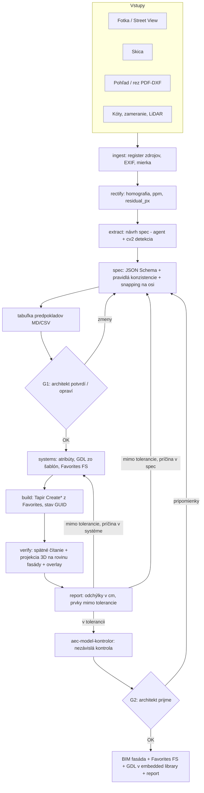

# ADR-001: BIM fasáda z obrázka (foto / skica / pohľad / rez → ArchiCAD 29)

| Pole | Hodnota |
|---|---|
| Stav | NAVRHNUTÉ (2026-10-19) |
| Rozhoduje | architekt (používateľ) – rozhodnutia delegoval na tím; otvorené otázky v kap. 11 |
| Nadväzuje na | `aec-archicad-modeler`, `aec-model-kontrolor`, `aec-prieskumnik`; súkromný Tapir 1.7.2 (`CreateRailings`, `CreateCurtainWalls`) |
| Repo | `C:\tapir-private` (C++ add-on, pravidlá v `CLAUDE.md` → „Adding or changing a command") |
| Piloty | A: Senec – Lichnerova (`OneDrive\AT_Verejny_priestor_Senec\Fasady_model`), B: administratívna CW fasáda z fotky |

## 1. Kontext

Cieľ používateľa: *„vstup obrázok, prípadne sketch, prípadne pohľady, rezy → výsledok BIM vymodelovaná fasáda"*, plne automaticky vrátane Favorites a GDL.

Čo už existuje a funguje:

| Oblasť | Stav (overené 2026-10-19, ak nie je uvedené inak) |
|---|---|
| Čítanie fotky | Pilot Senec: rektifikácia (`rect.py`, `fasady.py`: homografia, `ppm`, `facade_support`, `cam_height_check_m`), odčítanie otvorov `(s0, s1, v0, v1)` z metrickej mriežky, značky ODHAD. 52 domov hotových – ale ako **morfy** (plastický model), nie BIM prvky. |
| Tapir – prvky | Create/Modify Walls, Slabs, Windows, Doors, Openings, Columns, Beams, Roofs, Morphs, Meshes, Objects, Zones; súkromne `CreateRailings`, `CreateCurtainWalls` (raster, triedy buniek). |
| Tapir – systémy | Favorites (Get/Create/Update/Rename/Delete/Import/Export/Apply…), `CreateComposites`, `CreateSurfaces`, `CreateBuildingMaterials`, `CreateLayers`, `CreateProfiles` (len kópia existujúcej geometrie), GDL parametre prvkov aj podprvkov CW, `AddFilesToEmbeddedLibrary`, `ReloadLibraries`. |
| Tapir – kontrola | `Get3DGeometryOfElements`, `GetSubelementsOfHierarchicalElements`, `GetSectionElements`, `ChangeWindow`, `SaveCurrentWindowAsImage`, `GetElementPreviewImage`. |
| Medzery | Detaily zábradlia (len z Favorite; `ApplyFavoritesToElements` memo pri Railing/Stair/CW neaplikuje), definícia tried rámov/panelov CW (len výber z existujúcich), profil z polygónu, tvorba GDL objektov. |

Overené v hlavičkách DevKitu AC29 (`Support\Inc`):

| Funkcia | Zistenie | Dôsledok |
|---|---|---|
| `ACAPI_Element_ChangeDefaults` | memo sa používa **len** pre Window/Door/Object/Lamp/Room/Label/Picture/External (ACAPinc.h:2902) | detaily zábradlia cez defaults nejdú → cesta cez vzorový prvok |
| `ACAPI_Element_ChangeDefaultsExt` | výslovne podporuje `API_CurtainWallID`, `…PanelID`, `…FrameID`, `…JunctionID`, `…AccessoryID` (ACAPinc.h:2924) | triedy CW sa dajú nastaviť do predvolieb → Favorite |
| `ACAPI_Element_GetMemo` / memo masky | Railing: `railingSegments`, `railingPatterns`, `railingPosts`, `railingToprails`, `railingHandrails`, `railingPanels`, `railingBalusters`… (APIdefs_Elements.h:18125–18221) | čítanie áno; zápis cez `ACAPI_Element_Change` s memom **NEOVERENÉ** |
| `ACAPI_LibraryPart_Create/AddSection/Save` | existuje, označené *Legacy – use ACAPI::LM::GSMObject* (ACAPinc.h:2569); `GSMObject.hpp` v `Modules\ArchicadAPI\ACAPI\Library` | C++ cesta možná, ale preferujeme cestu bez C++ (kap. 8, T5) |
| `ACAPI_LibraryManagement_InterpretGDLScript3D` | existuje (ACAPI_Goodies.h:1234); `InterpretGDLScript` (2D) v AC29 nie je pod týmto menom | rýchly test 3D skriptu šablóny bez umiestnenia |
| `API_ProfileAttrType` + `profile_vectorImageItems` | profil z 2D výplní (`ProfileVectorImage`); DevKit odkazuje na príklad *Attribute_Test* | `CreateProfilesFromPolygons` je realizovateľné; príklad v lokálnom DevKite **NEOVERENÉ** |
| `ACAPI_Favorite_Create/Change` | `API_Favorite` s prvkom + memom, `Change` s `elementMask`/`memoMask` | či memo CW/Railing do Favorite prejde: **NEOVERENÉ** |

## 2. Rozhodnutie (súhrn)

| # | Rozhodnutie | Zdôvodnenie |
|---|---|---|
| D1 | Jediný kontrakt medzi „čítaním obrázka" a „modelovaním" je **strojová špecifikácia fasády** `facade-spec/1` (JSON + JSON Schema). Každá číselná hodnota nesie zdroj a istotu. | Oddelí neisté vnímanie od deterministického modelovania; moduly sa dajú testovať izolovane; Senec dáta sa dajú skonvertovať. |
| D2 | Poradie realizácie prvku: **natívny nástroj ArchiCADu → Favorite → GDL objekt zo šablóny → morf** (morf len ako vykázaná výnimka). | BIM hodnota (IFC, výkazy, editovateľnosť architektom); zhoda s pravidlami `aec-archicad-modeler` (zákaz „hranolov hmoty"). |
| D3 | Systémy (skladby, typy okien, CW systémy, zábradlia, profily) sú v špecifikácii **katalóg `systems`**; modul `systems` z neho idempotentne vyrobí atribúty a Favorites s prefixom `FS `. Prvky sa potom vytvárajú **len z Favorites**. | Favorite je jediná spoľahlivá cesta pre Railing/CW (overené); architekt dostane znovupoužiteľnú knižnicu. |
| D4 | Detaily, ktoré cez defaults nejdú (zábradlie), sa robia vzorom **„vzorový prvok"**: vytvor z najbližšieho Favorite → uprav prvok/podprvky → `CreateFavoritesFromElements` → zmaž vzor. | Používa overené príkazy; nový C++ len na úpravu detailov. |
| D5 | GDL objekty vznikajú z **malej sady parametrických šablón** (verzionované v repe), nie generovaním GDL per fasáda. Preferovaná cesta: XML šablóna → `LP_XMLConverter` (súčasť inštalácie ArchiCADu) → `.gsm` → `AddFilesToEmbeddedLibrary` → `ReloadLibraries`. C++ príkaz T5 len ak táto cesta zlyhá. | Nulový C++, žiadny reštart ArchiCADu; šablóna testovateľná mimo projektu. |
| D6 | Spätná kontrola je **dvojitá**: (a) čísla – spätné čítanie prvkov vs. špecifikácia, (b) obraz – ortografická projekcia 3D geometrie modelu na rovinu fasády prekrytá cez rektifikovaný vstup, odchýlky v cm. Natívny pohľad ArchiCADu (`ChangeWindow` + `SaveCurrentWindowAsImage`) je doplnok. | (b) je deterministické, beží v tichom režime a nepotrebuje pohľadový marker. |
| D7 | Človek v slučke má **dve brány**: G1 potvrdenie tabuľky predpokladov (pred stavbou), G2 prijatie výsledku (po kontrole). Inak beží slučka sama. | Architekt nechce programovať, ale musí schváliť to, čo nie je z kóty. |
| D8 | Orchestrácia v Pythone (`C:\tapir-private\private-tools\facade_pipeline\`), Tapir príkazy sú len atómy. Nové C++ príkazy sa zoskupujú do dávok (1 build + 1 reštart na inkrement). | Reštart robí používateľ; minimalizovať počet reštartov. |

## 3. Pipeline end-to-end



### 3.1 Vstupy a zdroj každej hodnoty

| Vstup | Rektifikácia / mierka | Typická istota | Pozn. |
|---|---|---|---|
| Fotka (čelná, šikmá) | homografia roviny fasády (úbežníky, `cv2.findHomography`), mierka z 1 známej šírky (model, zameranie, OSM) alebo 2 koncov | `meranie` ±3–10 cm (ODHAD, závisí od `facade_support`, uhla a ppm) | prvky mimo roviny (balkón, rímsa) sa posúvajú – poloha z 2 záberov alebo `odhad` (POSTUP Senec §10) |
| Skica | bez perspektívy; mierka z 1 kóty alebo z typovej výšky podlažia | `odhad`, pri kóte `kota` | skica je zámer, nie skutočnosť – hodnoty sa snapujú na raster |
| Pohľad / rez (PDF z CADu, DXF) | mierka z výkresu (DXF v mm presne, PDF z mierky + kontrola kótou) | `kota` / `meranie` ±1 cm | rez = hlavný zdroj hĺbok (ostenie, predsadenie, rímsy, skladby) |
| Zameranie, LiDAR | priamo v súradniciach modelu | `meranie` | päta, rímsa, hrebeň |
| Pravidlo / typológia | – | `pravidlo` | napr. parapet 0,9 m, ak nevidno; vždy do tabuľky G1 |

Úrovne istoty (`conf`): `kota` > `meranie` > `pravidlo` > `odhad` > `default` (hodnota systému bez podkladu). Do G1 idú všetky hodnoty pod `meranie`.

### 3.2 Človek v slučke

| Brána | Čo vidí architekt | Čo robí | Formát |
|---|---|---|---|
| G1 | tabuľka predpokladov: hodnota, jednotka, zdroj, istota, návrh; náhľad rektifikovaného obrázka s vyznačenými otvormi a osami | potvrdí / prepíše hodnotu / zmení systém (napr. „okná 3-krídlové") | `out/<spec>/assumptions.md` + `.csv` (stĺpec `schvalene`) |
| G2 | overlay model × vstup, tabuľka odchýlok, 3D snímka | prijme / napíše pripomienku vetou | `out/<spec>/report.md` |

Prázdna odpoveď v G1 = prijatie návrhov (plná automatizácia podľa želania); G1 sa nikdy nepreskakuje potichu – vždy sa vygeneruje a zaloguje.

## 4. Strojová špecifikácia `facade-spec/1`

Súradnice: **lokálny systém fasády** `s` (m po referenčnej čiare zľava doprava pri pohľade zvonku), `v` (m nad `z0`), `w` (m von z roviny fasády) – rovnaká konvencia ako `Path` v pilote Senec. Transformácia do modelu cez `reference`.

```json
{
  "schema": "facade-spec/1",
  "id": "M015",
  "reference": {"a": [12.40, -3.10], "b": [24.85, -1.95], "z0": {"v": -2.21, "src": "S3", "conf": "meranie"},
                "outside": "right_of_ab", "layer": "FASADA – M015"},
  "sources": [
    {"id": "S1", "type": "photo", "file": "01_podklady/foto/IMG_8441.JPG",
     "rect": {"H": [[...]], "ppm": 98.4, "residual_px": 2.1, "facade_support": 0.71, "scale_from": "width_model"}},
    {"id": "S3", "type": "survey", "file": "01_podklady/survey_model_xyz.npy"}
  ],
  "stories": [{"id": "1NP", "level": {"v": 0.00, "src": "S1", "conf": "meranie"}},
              {"id": "2NP", "level": {"v": 3.35, "src": "S1", "conf": "odhad"}}],
  "axes": {"s": [0.0, 2.10, 4.85, 7.60, 10.35, 12.45], "snap_tol": 0.05},
  "zones": [{"id": "Z1", "kind": "wall", "rect": [0, 12.45, 0, 7.20], "system": "wall.omietka_450"}],
  "openings": [{"id": "O1", "kind": "window", "rect": {"v": [2.10, 3.30, 0.95, 2.45], "src": "S1", "conf": "meranie"},
                "system": "win.2kr_ks", "reveal": {"v": 0.12, "src": null, "conf": "odhad"}, "sill_out": "sill.plech"}],
  "cw_fields": [{"id": "CW1", "polygon": [[0,0],[12.45,0],[12.45,3.6],[0,3.6]], "system": "cw.stl_50",
                 "u_pattern": {"kind": "FixedSizes", "sizes": [1.35]}, "v_pattern": {"kind": "FixedSizes", "sizes": [0.9, 2.7]},
                 "cells": [{"row": 0, "panel": "opaque"}]}],
  "railings": [{"id": "R1", "path": [[3.0, 3.35, 1.20], [9.0, 3.35, 1.20]], "system": "rail.plech_1000"}],
  "linear": [{"id": "L1", "kind": "cornice", "s": [0, 12.45], "v": {"v": 7.20, "src": "S1", "conf": "meranie"},
              "profile": "prof.rimsa_A"}],
  "slabs": [{"id": "B1", "kind": "balcony", "outline_sw": [[3.0,0],[9.0,0],[9.0,1.2],[3.0,1.2]], "v_top": 3.35, "system": "slab.balkon_180"}],
  "shading": [{"id": "SH1", "field": "CW1", "system": "gdl.louvers_h", "params": {"pitch": 0.25, "depth": 0.20, "angle": 30}}],
  "anchoring": [{"id": "A1", "applies_to": "cladding", "system": "anch.konzola_al", "spacing": [0.6, 1.2], "model": "property_only"}],
  "systems": {
    "wall.omietka_450": {"type": "composite", "layers": [["Omítka - venkovní", 0.02], ["EPS", 0.15], ["Zdivo", 0.30]]},
    "win.2kr_ks":  {"type": "window", "base_libpart": "Window 29", "frame": 0.07, "mullions": 1, "transoms": 0},
    "cw.stl_50":   {"type": "curtain_wall", "frame": {"width": 0.05, "depth": 0.15}, "panels": {"glass": 0.024, "opaque": 0.10}},
    "rail.plech_1000": {"type": "railing", "height": 1.0, "post_spacing": 1.5, "infill": "panel", "base_favorite": "FS base railing panel"},
    "prof.rimsa_A": {"type": "profile", "polygon_wv": [[0,0],[0.35,0],[0.35,0.12],[0.18,0.30],[0,0.30]], "material": "Omítka - venkovní"},
    "gdl.louvers_h": {"type": "gdl", "template": "FS_Louvers", "version": "1.0"}
  },
  "assumptions": [{"ref": "openings[O1].reveal", "value": 0.12, "why": "ostenie nevidno, typológia", "status": "pending"}],
  "tolerances": {"kota": 0.01, "meranie": 0.05, "pravidlo": 0.10, "odhad": null}
}
```

Pravidlá konzistencie (modul `spec`, bez ArchiCADu): otvory sa neprekrývajú a ležia v zóne `wall`; okná nad sebou zarovnané do osí (`snap_tol`); parapet ≠ 0 pri `conf=odhad` (pravidlo modelera č. 13); každý `system` existuje v katalógu; CW raster pokryje pole; zábradlie stojí na doske/parapete; žiadny prvok mimo `0…L`. Porušenie = chyba (nie varovanie).

Adaptér `from_senec`: prevod `domy_blok*.py` (otvory `(s0,s1,v0,v1)`, `z0`, `info["odhady"]`, rímsy zo `sbox`) do `facade-spec/1` – pilot A tak nevyžaduje nové čítanie fotiek.

## 5. Moduly a kontrakty

Balík `facade_pipeline` (Python 3.12). Každý modul = čistá funkcia nad súbormi; ArchiCAD potrebujú len `systems`, `build`, `verify`.

| Modul | Vstup | Výstup | ArchiCAD | Test izolovane |
|---|---|---|---|---|
| `ingest` | priečinok vstupov, `sources.yaml` | `sources[]` (typ, súbor, EXIF/GPS, mierka výkresu) | nie | fixture obrázky |
| `rectify` | `sources[i]`, ROI, známa šírka | rektifikovaný PNG + mriežka, `H`, `ppm`, `residual_px`, `facade_support` | nie | syntetická fasáda s known homography (chyba < 1 px) |
| `extract` | rektifikované obrázky, pohľady/rezy | návrh `facade-spec` (otvory, osi, podlažia, zóny, systémy z typológie) | nie | porovnanie so Senec `domy_blok` (recall otvorov) |
| `spec` | návrh spec, odpovede G1 | validovaná spec, `assumptions.md/.csv` | nie | JSON Schema + jednotkové testy pravidiel |
| `systems` | `spec.systems` | `manifest.json`: systém → atribút index / Favorite meno / libpart GUID | áno | na prázdnom testovacom projekte; idempotencia (2. beh = 0 zmien) |
| `build` | spec + manifest | prvky v ArchiCADe, `state.json` (GUID per `id` spec) | áno | idempotentný rebuild jednej fasády; maže len GUID zo stavu |
| `verify` | spec + state + rektifikované vstupy | `deviations.csv` (prvok, os, spec, model, Δ cm, tolerancia, OK), `overlay_*.png`, 3D snímka | áno (čítanie) | projekcia na syntetickom modeli |
| `report` | výstupy `verify`, história iterácií | `report.md` pre G2 | nie | snapshot test |
| `iterate` (I7) | spec (adaptér + `corrections`), state, výstupy `verify` | opravy spec `facade/corrections/<id>.json`, prestavané prvky, `i7/iterations.json`, výrezy PNG, `report_G2.md` | áno | `test_i7_loop.py` (umelá chyba v spec aj v modeli) |
| `photo_measure` (I7) | rektifikovaná fotka, očakávaná hrana | hrana v širokom okne: kandidáti, istota / dôvod nejednoznačnosti, posun dvojice hrán | nie | posun O6 o 0,20 m na fotke M015 |

Rozdelenie na agentov: `aec-prieskumnik` → `ingest` (fotky, Street View); čítanie (`rectify`, `extract`, `spec`) → `aec-archicad-modeler` v režime „čítanie" (alebo nový agent `aec-fasada-citac`, ak sa ukáže, že kontext nestačí); `systems` + `build` → `aec-archicad-modeler` (do ArchiCADu zapisuje vždy len jeden); `verify` → skript + `aec-model-kontrolor` nad overlaymi.

Konvencie v modeli: vrstva `FASADA – <spec.id>`, Element ID `<spec.id>.<prvok.id>` s príponou `?` pri `conf ∈ {odhad, default}` (pravidlo modelera č. 26), vlastnosti `FS_zdroj`, `FS_istota`, `FS_spec` (cez `CreatePropertyDefinitions` + `SetPropertyValuesOfElements`), Favorites `FS <system-id>`.

## 6. Mapovanie prvkov fasády na systémy ArchiCADu

| Prvok spec | Nástroj ArchiCADu | Systém (zdroj nastavení) | Tapir |
|---|---|---|---|
| `zones[kind=wall]` | Wall (skladba) | Composite + Favorite `FS wall.*` | `CreateComposites`, `CreateWalls`/`ModifyWalls` |
| `openings[window/door]` | Window / Door v stene | Favorite `FS win.*` (knižničný prvok + GDL parametre delenia) | `CreateWindows`/`CreateDoors`, `SetGDLParametersOfElements` |
| `openings[kind=opening]` | Empty Opening | – | `CreateOpenings` |
| `cw_fields` | Curtain Wall | Favorite `FS cw.*` s triedami rámov/panelov | `CreateCurtainWalls` + **T2** |
| `railings` | Railing | Favorite `FS rail.*` (vzorový prvok) | `CreateRailings` + **T3** |
| `linear` (rímsa, pás, sokel, atika) | Beam / Wall s Complex Profile | Profile atribút + Favorite | **T1**, `CreateBeams`/`CreateWalls` (priradenie profilu **NEOVERENÉ** v schéme Tapiru) |
| `slabs[balcony]` | Slab | Composite | `CreateSlabs` |
| obklad (panely, rastre) | LOD1 vrstva skladby; LOD2 CW ako rainscreen alebo GDL pole panelov | composite / `FS cw.*` / `FS_CladdingPanels` | existujúce + T2 / šablóna |
| `shading` (lamely, slnolamy) | Object (GDL) | šablóna `FS_Louvers` | GDL cesta D5, `CreateObjects` |
| šambrány, ozdoby (pilot A) | Object (GDL) `FS_Surround`; výnimočne morf | šablóna | D5 |
| `anchoring` | len vlastnosti (LOD1–2), GDL `FS_Bracket` pole (LOD3) | – | `SetPropertyValuesOfElements` |

## 7. Gap analýza

Priorita = frekvencia prvku na bežných fasádach (V vysoká / S stredná / N nízka) × prínos; náročnosť: M (≤ 1 deň), S (2–4 dni), V (týždeň+ / výskum).

| Prvok | Čo treba | Čo API/Tapir má | Čo chýba | Ako doplniť | Náročnosť | Priorita |
|---|---|---|---|---|---|---|
| Stena + skladba | stena po zóne, skladba, Home Story, top link | `CreateWalls` (`structureType` + `compositeId`), `CreateComposites`, `GetComposites` | nič (**overené I2**: prvá vrstva skladby = vonkajšie líce pri ref. čiare `Outside`) | `systems.py`: skladba porovnaná `GetComposites` pred zápisom; Favorite `FS wall.*` zo vzorovej steny (povrchy bez prepisu) | M | V |
| Okná / dvere – poloha | otvor v stene, parapet, výška | `CreateWindows/Doors` (z Favorite) | nič | – | M | V |
| Okná – typ (delenie, rám) | počet krídel, priečnik, šírka rámu | GDL parametre prvku, `CreateFavoritesFromElements` / `UpdateFavoritesFromElements` | **overené I2**: `facade/gdl_param_map.json` (Double Window 27, Door 27, Door with Sidelight on Side 1 and Transom 27, Garage Double Door 27); počet krídel = podtyp knižničnej časti, nie parameter; obsah Favorite sa nedá čítať → idempotencia cez manifest s hashom | podtyp, ktorý v šablóne nemá Favorite, ide len cez `libraryPartName` → **T7** | S | V |
| Ostenie, vonkajší parapet | hĺbka osadenia, parapetný plech | **overené I2**: `ModifyWindows/ModifyDoors` `refSide: true` + `revealDepthOffset` (od vonkajšieho líca; spätne `AC_wido_sill`); typ ostenia `gs_reveal_type_int` = 2, omietka sa neotáča `gs_bAutoTurnIn` = false | ~~`revealDepthLocation` sa nedá nastaviť~~ – **vyriešené I3 (T8)**: `revealDepthLocation: Side` + `revealDepthOffset` = hĺbka od vonkajšieho líca aj pri kompozitnej stene (geometria zhodná s kalibráciou I2 na 0 mm); pozor: pri `Side` ArchiCAD neobnoví GDL `AC_wido_sill` → spätné čítanie z `GetDetailsOfElements` | – | M | S |
| Dvere s bočným svetlíkom a nadsvetlíkom | výklad + dvere v jednom ráme, parapet pod svetlíkom | podtyp `Door with Sidelight on Side 1 and Transom 27` z Favorite „… vchodové 03" | nič (**overené I2**: otvor v stene má tvar L, parapet ostane stenou) | `merged_into` v spec; šírka svetlíka = viditeľná + `gs_frame_width` | M | V |
| Balkónová doska | doska, hrúbka, presah | `CreateSlabs` | nič | – | M | V |
| Zábradlie – výška a výplň | výška, rozostup stĺpikov, madlo, výplň (panel/priečky) | `CreateRailings` z Favorite, čítanie memo | zápis detailov | **T3** `ModifyRailingDetails`; fallback: 4–5 ručných Favorites (jednorazový krok) | V | V |
| Rímsy, pásy, sokel, atika | ťahaný profil z polygónu | `CreateProfilesFromPolygons` (T1, I3), nosník/stĺp s `profileId` | **overené I3**: profil x = von z fasády (vpravo od smeru nosníka), y = hore od `level`; stĺp: x, y v lokálnom systéme otočenom o `axisRotationAngle`; `Get3DGeometryOfElements` vracia pre Beam/Column prázdne telesá – geometria je na segmentoch (`GetSubelementsOfHierarchicalElements` → segmenty) | oprava T9 (zbierať telesá segmentov priamo v príkaze) | M | V (historické) / S |
| CW – raster a bunky | raster, triedy buniek | `CreateCurtainWalls` (overené) | nič | – | – | S |
| CW – systém (rámy, panely) | šírka/hĺbka rámu, typ panelu, hrúbka, materiál | výber existujúcich tried | definícia tried | **T2** `SetCurtainWallSystemDefaults` (+ Favorite) | S | S |
| Obklad – panely | raster panelov, škáry, hrúbka | skladba (LOD1), CW (LOD2) | GDL pole panelov | šablóna `FS_CladdingPanels` | S | S |
| Tienenie – lamely | pole lamiel, rozostup, uhol, hĺbka | `CreateObjects`, GDL parametre | objekt | šablóna `FS_Louvers` | S | S |
| Parapetný / nadpražný panel | nepriehľadné pole v CW alebo v stene | CW triedy (po T2) | – | T2, alt. `FS_SpandrelPanel` | M | S |
| Šambrány, nadokenné rímsy | rám okolo otvoru s profilom | – | objekt | šablóna `FS_Surround` (profil + rozmery otvoru) | S | S (pilot A) / N |
| Kotvenie | info, LOD3 konzoly | vlastnosti | – | vlastnosti; `FS_Bracket` až na požiadanie | M | N |
| Zdroj a istota v modeli | vlastnosti per prvok | `CreatePropertyDefinitions`, `SetPropertyValuesOfElements` | nič | – | M | V |
| Kontrola – projekcia | 3D geometria → rovina fasády | `Get3DGeometryOfElements` | nič (Python) | modul `verify` | S | V |
| Kontrola – natívny pohľad | pohľad rovnobežný s fasádou | `ChangeWindow`, `SaveCurrentWindowAsImage` | tvorba pohľadového markera | **T6** `CreateElevationAlongLine` | V | N |
| GDL – tvorba objektu | `.gsm` zo šablóny | `AddFilesToEmbeddedLibrary`, `ReloadLibraries`, GDL params | nič (**overené I4**: `LP_XMLConverter` AC29 kompiluje aj interpretuje skripty, T5 netreba) | `facade/gdl_build.py` + `facade/gdl/templates/` | M | V |

## 8. Nové Tapir príkazy

Spoločné: schéma cez `tools/new_command.py`, registrácia v `AddOnMain.cpp` s verziou z `tools/package_info.json`, príklad v `Examples/`, test v `private-tests/test_tapir_private.py`; každý zápis v `ACAPI_CallUndoableCommand`; po vytvorení vrátiť GUID/index a pri chybe text chyby per položka (nie celá dávka).

| ID | Príkaz | Vstup (polia) | Výstup | API | Riziká |
|---|---|---|---|---|---|
| T1 | `CreateProfilesFromPolygons` | `profiles[]: {name, polygons[]: {outer: [[x,y]…], holes?: [[[x,y]…]]}, buildingMaterial (name/index), useWith: {wall, beam, column, handrail}, overwriteExisting}`; x = von z fasády, y = hore, m | `attributes[]: {attributeId, index}` / `error` | `ACAPI_Attribute_CreateExt` / `ModifyExt` s `API_ProfileAttrType`, `API_AttributeDefExt.profile_vectorImageItems` (`ProfileVectorImage`: výplň + `ProfileItem` so stavebným materiálom) | zostavenie `ProfileVectorImage` (HGX) nie je triviálne; vzor *Attribute_Test* v DevKite **NEOVERENÉ** lokálne; oblúky → polygón |
| T2 | `SetCurtainWallSystemDefaults` | `frameClasses[]: {name, kind (generic / buttGlazed / …), width, depth, offset, buildingMaterial, surface?}`, `panelClasses[]: {name, kind (glass/opaque), thickness, buildingMaterial}`, `boundaryFrameClass`, `favoriteName?` | `frameClasses[]: {name, classIndex}`, `panelClasses[]`, `favoriteName` | `ACAPI_Element_GetDefaultsExt` / `ChangeDefaultsExt` pre `API_CurtainWallID` + memo `cWallFrameDefaults`, `cWallPanelDefaults`; podprvky `API_CurtainWallFrameID/PanelID`; potom `ACAPI_Favorite_Create` (alebo vzorový prvok + `CreateFavoritesFromElements`) | mapovanie `kind` na GDL objekty rámov (`libInd`) a ich parametre; či `Favorite_Create` uloží CW memo **NEOVERENÉ** → záložná cesta vzorový prvok |
| T3 | `ModifyRailingDetails` | `railings[]: {elementId, height?, segments?: {postSpacing, postLibPart?}, toprail?: {enabled, height, profile/libPart}, handrail?: {enabled, height, side}, infill?: {kind: panel/balusters/rails, panelThickness?, balusterSpacing?, railCount?}}` | `results[]: {elementId, changed: [...], error?}` | `ACAPI_Element_GetMemo` (masky `APIMemoMask_Railing*`), úprava `railingSegments`, `railingPatterns`, `railingPosts`, `railingToprails`, `railingHandrails`, `railingPanels`, `railingBalusterSets`; zápis `ACAPI_Element_Change` s memoMask alebo po podprvkoch (`API_RailingPostID` …) | **najvyššie riziko**: hierarchia vzorov, konzistencia indexov, chýbajúca dokumentácia správania; zápis memo **NEOVERENÉ** → najprv spike (1 deň), pri neúspechu fallback ručné Favorites + zmena len výšky |
| T4 | `CreateFavoritesFromDefaults` | `favorites[]: {name, elementType (Window/Door/Object/Lamp), libPartName, gdlParameters{}, layer?, classifications?, properties?}` | `favorites[]: {name, created/updated}` | `ACAPI_Element_GetDefaults` → memo `params` (`ACAPI_LibraryPart_GetParams`) → `ACAPI_Favorite_Create/Change` | len knižničné prvky (memo podľa doc. 2902); pre ostatné vzorový prvok (D4) |
| T5 | `CreateLibraryPartFromScripts` (len fallback D5) | `{name, parentSubtype (Object/Window/Door), scripts: {master, 2d, 3d, parameter, ui?}, parameters[]: {name, type, value, description}, target: embedded}` | `{libPartGuid, index}` | `ACAPI_LibraryPart_Create`, `AddSection`, `GetSect_ParamDef`, `Save` (legacy) alebo `ACAPI::LM::GSMObject` | legacy API; cieľová lokácia embedded library **NEOVERENÉ**; chyby GDL až pri umiestnení |
| T6 | `CreateElevationAlongLine` | `{name, begin, end, depth, viewDirection, horizontalRange, verticalRange}` | `{elementId, navigatorItemId}` | `ACAPI_Element_Create` s `API_ElevationID` + marker (`ChangeDefaultsExt` markera) | marker a rozsahy sú zložité; nízka priorita, projekcia v `verify` to nahrádza |
| T7 | oprava `CreateWindows/CreateDoors.libraryPartName` (nález I2) | bez zmeny schémy | prvok, ktorého GDL parametre sa dajú čítať aj zapisovať | `ApplyWindowOrDoorLibraryPartToDefaults` dáva do memo `params` výsledok `ACAPI_LibraryPart_GetParams`; vzniknutý prvok potom zlyhá v `ACAPI_LibraryPart_OpenParameters` (APIERR_GENERAL) v Get/SetGDLParametersOfElements a Favorite z neho zdedí to isté (overené 2026-10-19 na „Double Door with Transom 27" a „Door with Sidelight on Side 1 and Transom 27"; tie isté podtypy cez Favorite fungujú). Návrh: po vytvorení prepočítať parametre (`OpenParameters` na libpart + `GetActParameters` + `ACAPI_Element_Change` s memom `params`), alebo brať defaults zo vzorového prvku | bez T7 sú dostupné len podtypy, ktoré majú Favorite v šablóne – dvojkrídlové dvere s nadsvetlíkom chýbajú (brána O2 pilota A je výnimka) |
| T8 | `revealDepthLocation` v `ModifyWindows/ModifyDoors` (+ čítanie v `GetDetailsOfElements`) (nález I2) | `revealDepthLocation: Side / Core` | `executionResults` | `API_WindowType.revealDepthLocation` (`APIWDRevealDepth_Side/Core`) s maskou | malé; dnes nahradené odpočtom vonkajších vrstiev skladby v `build.py` |

## 9. Poradie implementácie (inkrementy)

Každý inkrement končí akceptačným testom **naostro v ArchiCADe 29** na kópii projektu (nikdy template `C:\ArchicadTemp`), skriptom s timeoutom a viditeľným výstupom, a záznamom do `private-tests`.

| # | Obsah | Nový C++ / reštart | Akceptačný test (naostro) | Čo z pilotov pôjde vymodelovať |
|---|---|---|---|---|
| I1 | `facade-spec/1` (podmnožina: `reference`, `stories`, `zones[wall]`, `openings`), validátor, adaptér `from_senec`, `build` stien + okien + dverí z existujúcich Favorites, `verify` s projekciou a overlayom | nie | Senec dom **M015_L1** (6 okien, 1 dvere): počet otvorov v modeli = spec; Δ poloha/rozmer otvorov model vs. spec ≤ 1 cm; overlay PNG cez `fasada_*_rektif.jpg`; 2. beh `build` = 0 zmien; čas < 2 min | **viditeľný výsledok**: prvá BIM fasáda (stena + výplne) vedľa morfového modelu; pilot A L1 |
| I2 ✔ | katalóg `systems`: skladby (`CreateComposites`), typy okien (vzorový prvok → `CreateFavoritesFromElements`, `gdl_param_map.json`), vlastnosti `FS_*`, tabuľka G1 | nie | 2 typy okien z spec → 2 Favorites `FS win.*`; okná majú delenie podľa spec (GDL parametre čítané späť = spec); stena má skladbu; každý prvok má `FS_zdroj`/`FS_istota`; idempotentný 2. beh | pilot A L1 s typmi okien a skladbou; G1 prvýkrát s architektom |
| I3 ✔ | **T1** `CreateProfilesFromPolygons` + **T4**; `linear` (rímsy, pás, sokel) ako nosník/stena s profilom; balkónové dosky | áno (T1 + T4 v 1 builde) | profil z polygónu: plocha prierezu z ArchiCADu = polygón ±1 %; rímsa M016/M062 na výške spec ±1 cm; overlay rímsy ±3 cm voči fotke | pilot A L2 (rímsy, sokel, podokenné pásy, balkónové dosky) |
| I4 ✔ | GDL šablóny cez `LP_XMLConverter`: `FS_Louvers`, `FS_SpandrelPanel`, `FS_CladdingPanels`, `FS_Surround`; test šablón mimo projektu | nie (ak converter funguje) | každá šablóna: `.gsm` sa načíta, objekt sa umiestni `CreateObjects`, `SetGDLParametersOfElements` zmení rozmer, 3D bbox z `Get3DGeometryOfElements` = spec ±5 mm; `ReloadLibraries` bez chýb | pilot A L2–L3 (šambrány); pilot B lamely, parapetné panely |
| I5 ✔ | **T2** `SetCurtainWallSystemDefaults`; `cw_fields` zo spec (pilot A: výklady a presklené vstupy) | áno | CW systém zo spec: šírka/hĺbka rámov a hrúbky panelov čítané späť (`GetSubelements…` + GDL parametre podprvkov) = spec; Favorite `FS cw.*` vytvorí rovnaké CW; overlay rastra ±2 cm voči kótam | pilot B: celá CW fasáda (raster, nepriehľadné parapety, rámy) |
| I6 ✔ | **T3** `ModifyRailingDetails` (spike → implementácia alebo fallback); pilot A: balkóny + zábradlia | áno | zábradlie zo spec: výška ±1 cm, počet stĺpikov = dĺžka / rozostup (+1), typ výplne zhodný; Favorite `FS rail.*` z neho dá to isté | balkóny pilota A (L2), francúzske okná a terasy pilota B |
| I7 ✔ | slučka iterácií automaticky (príčina v spec vs. v systéme), `report`, `aec-model-kontrolor` nad overlaymi, voliteľne **T6** | voliteľne (nepoužité) | 1 umelá chyba v spec (posunuté okno o 20 cm) → `verify` ju nájde, slučka opraví, 2. iterácia v tolerancii; G2 report | oba piloty end-to-end |
| I8 | akceptácia s architektom | nie | pilot A: 1 dom L2 end-to-end z fotiek; pilot B: 1 fasáda z 1 fotky + 1 kóty; G2 prijaté | – |

Poznámka k reštartom: I3, I5, I6 = 3 buildy (~5 min) + 3 reštarty ArchiCADu používateľom. Ak T3 spike vyjde, dá sa T2 + T3 spojiť do jedného buildu. T7 a T8 (nálezy I2) pribaliť do buildu I3.

**I7 – slučka build → verify → oprava (2026-10-19):** `private-tests/test_i7_loop.py --regression` 44/44 PASS naostro (pilot A, prepnutie SaveProject → OpenProject na pilot B a späť; v ňom `test_pilot_a.py --save` 126/126 a `test_pilot_b.py --save` 32/32 po slučke). Bez C++ a bez nového Tapir príkazu (T6 netreba).
- **Slučka** `facade/iterate.py` (`python iterate.py A|B`): build → verify → zoznam odchýlok nad toleranciou (riadky parametrov / 3D, typové riadky, chýbajúci prvok, hrany na fotke explicitné aj automatické, lišty CW) → klasifikácia → opravy → znova build / verify, max 3 kolá + potvrdzujúce kolo. Každá oprava musí v ďalšom verify znížiť svoju chybu (meria ju verify vlastným úzkym oknom na novej hrane), inak sa vráti (`status: reverted`) a prvok sa prestaví. Záznam `<out>/<id>/i7/iterations.json` (história behov: nálezy, opravy, vyhodnotenie, súhrn kontrol fotky, systematické posuny), výrez PNG ku každej odchýlke voči fotke, `report_G2.md` per pilot (`C:\FacadePilot\out\report_G2.md`, `C:\FacadePilot\pilot_B\out\report_G2.md`).
- **Triedy:** `build` = verify-riadky model ≠ spec → prvok sa prestaví zo spec (`build(rebuild=…)`, CW = `<id>.cw` + otvor), spec sa nemení. `spec` = model = spec, hrana na fotke inde → premeranie na rektifikovanej fotke v plnom rozlíšení (`facade/photo_measure.py`): dve protiľahlé hrany mimo → hľadá sa **posun dvojice hrán** v okne ±35 cm (oba skoky naraz, jednoznačné maximum); jedna hrana → okno ±10 cm, istá len ak: jeden silný skok (≥ 12, súper < 0,6×), tretiny hrany ±1,5 cm, hrana **končí na ostení** (za ostením skok < 0,3× – inak patrí širšiemu predmetu: tabuľa, markíza, parapet; 0,3–0,5× len s potvrdením istou hranou susedného otvoru v tej istej línii), nesplýva s iným prvkom modelu (sill, pás – `proj_boxes` z verify), leží **mimo** otvoru spec (spec číta murovaný otvor; skok vnútri = rám/krídlo) a ≤ 8 cm. Oprava = záznam v `facade/corrections/<id>.json` (`facade-corrections/1`: cesta, pred, po, `src` `I7.<k>`, `conf` meranie, dôkaz, výrez); adaptéry ho aplikujú (pilot A na typový súbor pred odvodením – parapet a šambrána otvoru idú s ním; pilot B na spec v `from_photo.py`), neaktuálny záznam sa preskočí a vypíše (`corrections_stale`). Spec po oprave musí prejsť validátorom. `ambiguous` = nečitateľná / dve hrany / tretiny nesúhlasia / zakrytá / spoločné ostenie dotýkajúcich sa otvorov / dvojitá lišta → neopravuje sa, ide do G2 s výrezom a ako zjednodušenie do spec (G1); ak široké premeranie dá hranu v tolerancii, je to „model potvrdený“. `systemic` = ≥ 6 hostiteľov, ≥ 80 % rovnaké znamienko, |medián| ≥ 1,5 cm → posun rámu fotky len ak celková chyba klesne o ≥ 20 % a nič nevypadne z tolerancie (offline test; na pilotoch nespustené: rovnaké znamienko ≤ 0,83, medián ≤ 1,1 cm).
- **Akceptácia:** (1) umelá chyba v spec: M015 okno O6 v typovom súbore +0,20 m (parapet a šambrána s ním) → verify: hrany O6 / O6_sur mimo, trieda `spec`, posun dvojice ostení −20,1 cm → spec [3,3588; 4,3689] vs. pôvodné [3,36; 4,37] (−0,1 cm), 2. iterácia: chyba 20,1 → 0,6 cm, verify PASS; potom prestavané z repo spec. (2) umelá chyba v modeli: CW výkladu O1 domu M062 posunutý `MoveElements` o 0,10 m → 8 riadkov `build` (rám, 3D 10,0 cm) → prestavaný `O1.cw` (nový GUID), 20/20 riadkov v tolerancii, spec nezmenená. (3) reálne: **M015** 9 nálezov → opravené vrchy parteru na murovaný otvor O2 3,13 → 3,1887 (+ priečka brány ostáva: `transom_h` 0,89 → 0,9487), O3 3,13 → 3,1839, O4 3,13 → 3,1775 (chyba 5,9 / 5,4 / 4,8 → 0,0 / 0,9 / 0,0 cm); kontroly fotky v tolerancii 49/58 → 52/58, medián 1,19 → 0,99 cm; ostáva O1 vrch (tabuľa kvetinárstva – skok za ostením 0,34×, bez potvrdenia), O1 pravá (spoločné ostenie s O1b), O2 pravá (dve hrany 4,500 / 4,524), O4 spodok (nečitateľný), spodky O5/O6 (parapetný plech pokračuje mimo / dve hrany). **M062** 14 nálezov → opravená pravá hrana suterénneho okna O5 2,25 → 2,30 (5,0 → 0,0 cm), kontroly 30/44 → 31/44; výklad O1–O3 ostáva celý nejednoznačný (markíza nad otvormi = dve hrany, spoločné ostenia, hrany vnútri otvoru = rám), O5/O6 ľavé hrany vnútri otvoru, O8/O9 spodky (dve hrany). **M016** 5 nálezov, 0 opráv: spodky O8/O9 splývajú s parapetmi `O8_sill`/`O9_sill`, vrch O7 pokračuje mimo otvoru (pás B1), O5 ľavá vnútri, O1 ľavá dve hrany. **Pilot B** 13 nálezov (CW_1NP_15 + 12 nečitateľných líšt), 0 opráv: stĺpik premeraný v každom páse poľa – CW_1NP_15 st. 1: najtmavšia lišta v 3/4 pásoch pri modeli (+0,8 / +0,8 / +0,3 cm), v parapetnom páse 5491 px (+5,1 cm, tieň konzoly / dvojitá lišta) → model potvrdený, spec ostáva; 11 ďalších rovnako potvrdených, CW_1NP_11 st. 2 pásy nesúhlasia. (4) 2. beh slučky = 0 opráv na všetkých štyroch fasádach; regresia pilotov PASS. (5) G2 reporty s výrezmi a súhrnom pred/po.
- **Zmeny testov (len kde spec opravila slučka z fotky s dôkazom):** `test_i2_m015.py` B2 a `test_i3_m015.py` C4 – priečka brány O2 sa porovnáva so spec (`transom_h` 0,89 → 0,9487 z opravy `M015_L1.c2`), nie s literálom; kontrola nie je slabšia. Typový súbor M015: text zjednodušenia parteru aktualizovaný (O2–O4 opravené, zvyšok nejednoznačný). Schéma `facade-spec/1`: typ zdroja `iteration`.
- **Obmedzenia / NEOVERENÉ:** prahy premerania (skok 12, súper 0,6×, pokračovanie 0,3/0,5×, 8 cm, „mimo otvoru“) sú nastavené na troch fotkách Senca – na iných fasádach NEOVERENÉ; pravidlo „mimo otvoru“ platí len pre spec, ktorá číta murovaný otvor; oprava M062 O5 (suterénne okno mimo zoznamu zadania) je istá podľa pravidiel, voči zameraniu NEOVERENÉ; pilot B: dvojitá lišta môže byť aj dve hrany toho istého stĺpika (lícna plocha 6 cm) – nerozlíšené, model ponechaný; automatická oprava osí rastra CW pilota A a vodorovných hrán pilota B nie je v I7 (na pilotoch nebola potrebná – vykázané ako `ambiguous`); `aec-model-kontrolor` nad overlaymi v tomto behu nebežal (subagent ho nevie volať) – zostáva na orchestrátora pred G2.

**Pilot B – fasáda z jednej fotky bez pripravených dát (2026-10-19):** `private-tests/test_pilot_b.py` 32/32 PASS (offline: adaptér izolovane `python -I`, validátor, 9 negatívnych prípadov; online: build, 2. build = 0 zmien, `verify_b`, sonda predvolieb LOP, G1, `SaveProject`); regresia `test_pilot_a.py` 125/125 PASS po návrate do pilota A. Vstup: „Frontsicht Westteil Südfassade Gebäude B HAW Hof“ – PantheraLeo1359531, CC BY 4.0, Wikimedia Commons (9504 × 4836 px, SHA-1 `b6b65321746e87a4e55fb843fe07f9bb53b45283`; súbor nie je v gite). Projekt `C:\FacadePilot\Fasada_pilot_B.pln` (kópia `Template_v10_SK.pln`), výstupy `C:\FacadePilot\pilot_B\out\` (spec, `HOF_B\` overlaye, CSV, G1) a `work\` (rektifikovaná fotka, merania, odčítanie).
- **Adaptér** `facade/adapters/from_photo.py` (ingest → rectify → kamera → extract → spec): SHA-1 + EXIF; **rectify** = spoločný y-posun dy(x) (kubika) z 5 dlhých vodorovných hrán (čelo strechy, červené pásy) – čiary klesali k pravému okraju o ~12 px rovnako vo všetkých výškach (deformácia obrazu, nie súdkovitosť); po korekcii ≤ 2,4 px rms, max posun 15,6 px; zvislice pilierov 2–3 px/1000 px (ponechané). **Kamera** (pinhole čelného záberu, w = von z roviny): cx = 4728 px (konzola ochodze, ktorá sa premieta zvislo), k_r = 0,9453 (päta vs. hrot 40 konzol → hĺbka ochodze 1,39 m), cy = 3795 ± 95 px (úbežník tyčí bočného zábradlia, obe ochodze sa líšia o 190 px – vykázané), k_f = 0,919 (škáry podhľadu → presah strechy 2,06 m, podhľad stúpa k čelu o 0,23 m), f = 5324 px (EXIF 20 mm / 35,7 mm, ODHAD). **Mierka** zo zábradlia 1,05 m (ODHAD ±10 %) → 209 px/m v rovine čiel stropov, D0 = 25,5 m. Kontroly: krídlo dverí ústupu 2,34 m (zadanie 2,10 → +11 %; zodpovedá radu DIN 18101 2,26 / 2,385 m), rozostup konzol 1,261 m (modul 1,25), konštrukčná výška podlažia 3,67 m → mierka ponechaná, istota ODHAD. Osi LOP odčítané okom na výrezoch 1:1 a spresnené na stred tmavej lišty (automatická detekcia ich nezávisle nájde v 37 zo 49), dvere = sklo namiesto perforovaného parapetného panelu (pravidlo farby + kontrola okom), prízemie: osi z medzier medzi žalúziami, rovina žalúzií prízemia z pomeru polôh voči stĺpikom poschodí (1,0071 → 0,18 m pred stĺpikmi poschodí).
- **Spec** `facade-spec/1#I7b`: `cw_fields` bez `zone` = **voľne stojaca LOP** (`reveal` = líce rámov za rovinou fasády, `story`, `photo_w`), `slabs[]` (obrys v (s, w): ochodze, čelá stropov), `linear` s osou **`w`** (nosník kolmo na fasádu – konzola, `w_span`), druhy `bracket` / `column` / `eaves`, objekty `louvers` (FS_Louvers, `gdl_expect`), `stories[].floorIndex/name` (podlažia projektu zo spec; každý prvok dostane podlažie podľa svojej päty – pravidlo modelera 2), zábradlie `on` = doska. Validátor: LOP mimo steny (raster, bunky, dvere v spodnom rade, reveal ≥ 0, prekryv v rovnakej hĺbke), dosky (platný polygón, 0..L), žalúzie pred poľom LOP a nie za jeho lícom, konzoly, podlažia.
- **Build**: `SetStories` zo spec (suterén šablóny ponechaný), `Home` = podlažie podľa päty, `plan_slabs`, konzoly (os w), `systems.classify_unclassified` (prvok bez klasifikácie dostane položku podľa druhu – inak FS_* nejdú zapísať; nulové GUID klasifikácie sa preskočí). **Nálezy:** `CreateBeams/Columns/Slabs/Objects/CurtainWalls/Railings` berú z absolútne (offset od podlažia dopočítajú), `CreateWalls` relatívne k `floorIndex` – na pilote A neviditeľné (podlažie 0 = úroveň 0), opravené pre oba piloty; z rámov/panelov LOP v `GetDetailsOfElements` je relatívne k podlažiu LOP (`cw_verify` opravené); GDL uhol (`lamAng`) sa zapisuje v stupňoch, číta v radiánoch; SK šablóna má CZ knižnicu 26 – bez `CW Door 27`, slovenské názvy materiálov / povrchov / favoritov.
- **Postavené (161 prvkov):** 23 LOP `FS cw.hof_b` (stĺpik 0,06, obvodový rám 0,03 → dve susedné LOP = jeden stĺpik; parapetný panel z perforovaného plechu, sklo; 10 LOP s dverným panelom: francúzske dvere 1.NP ×4, 2.NP ×3, dvere ústupu ×3), 56 žalúzií `FS_Louvers` (výška spustenia z fotky: 2.NP / 1.NP ~1,93–2,01 m, prízemie po pätu), 2 ochodze (doska 0,17 m) + 2 zábradlia, 64 konzol, 6 pásov (červené 0,18 m, sivá skrinka prízemia), presah strechy = nosník s klinovým profilom, okrúhly stĺp Ø 0,55 m (hĺbka ODHAD), 2 piliere + 2 nadpražia ústupu (hĺbka ústupu 0,97 m z bočnej steny piliera), 2 čelá stropov (0,48 m); podlažia 0 / 3,605 / 7,276 / 10,447 m.
- **Akceptácia:** čítanie späť 0 nezhôd; 1137/1137 riadkov parametre + 3D ≤ 1 cm (max 0,82 cm = natočené lamely), podlažie 161/161, LOP (raster, profily, triedy panelov po bunkách, dverné panely s krídlami) a zábradlia 83/83; fotka (relatívne – mierka je ODHAD): 14 vodorovných hrán (pásy, skrinka, čelo strechy, hrany ochodzí) medián ≤ 1,2 cm (max vzorka 2,9 cm), čitateľné stĺpiky 14/15 v ±3 cm (CW_1NP_15 pri 5501 px: 5,1 cm – v parapetnom páse dvojitá lišta, NEJEDNOZNAČNÉ), 12 líšt nečitateľných (kontrast < 8, vypísané); 2. beh = 0 zmien; predvoľby LOP obnovené (nezávislá sonda). Overlaye `pilot_B\out\HOF_B\overlay_HOF_B.png`, `overlay_detail_HOF_B.png`, `overlay_detail_bez_zaluzii_HOF_B.png`; odčítanie `pilot_B\work\HOF_B_readings.png`.
- **Výnimky / zjednodušenia:** R1 – favorit „Oceľové horizontálne zábradlie - bočné kotvenie“ cez API vytvorí len 2 stĺpiky (bez madla a tyčí, výška ostane 1,0) → použitý „Oceľové vertikálne zábradlie“ (zvislé tyčky; fotka: madlo + 3 + 7 vodorovných tyčí), madlo presahuje koniec o 0,10 m (favorit); dverný panel „Dvoukřídlé dveře LOP 26“ (dvojkrídlové); dvere = samostatná LOP (jeden vzor riadkov na LOP), stĺpik pri dverách po celej výške (na fotke končí v priečke); povrch tried LOP sa nezachová (nález I5); konzola = vodorovný nosník 0,08 × 0,22 (zúženie 0,11–0,33 nemodelované); rošt = plná doska; strešná doska a podhľad za fasádou nemodelované; prízemie: rovina skla (ODHAD) a dvere neviditeľné; pravých ~13 % 1.–2. NP pod stromom = raster z prízemia (pravidlo), fasáda pokračuje za okraj fotky; 2 odkvapové zvody nemodelované (TZB); biela plocha vľavo nejednoznačná; G1 má 657 riadkov (väčšina parametre žalúzií ODHAD).
- **Nové gapy:** LOP so zrušenými rámami / rozdielnym vzorom riadkov po stĺpcoch (dvere po priečku v jednej LOP); zábradlie s vodorovnými tyčami cez API (R1, favorit SK šablóny); zjednotiť z v `CreateWalls` (absolútne ako ostatné Create*); zúžená konzola (GDL `FS_Bracket`); druhý záber pre hĺbky (cy, rovina skla prízemia, stĺp); G1 zoskupiť po systémoch (opakované parametre).

**Pilot A – CW výkladov, balkóny, zábradlia (I5/I6 na domoch, 2026-10-19):** `private-tests/test_pilot_a.py` 126/126 PASS (v ňom regresia `test_i4_gdl.py --with-i3` 52/52 → I3 50/50 → I2, I1; `SaveProject`). Domy sa stavajú z `build_spec(house, i6=True)` – vrstva `i6` typového súboru; základná spec bez nej ostáva zmluvou I1–I4 a test ju naďalej kontroluje offline s pôvodnými očakávaniami. **Spec** `facade-spec/1` rozšírená: `cw_fields[]` (pole v zóne: `rect`, `u_axes`/`v_axes` = osi stĺpikov a priečok, `cells` s druhom panelu, `reveal` = vonkajšie líce rámov za lícom steny, `replaces`), `balconies[]` (`s`, `w_side`, `w_crown`, `v_top`; zadná hrana po lícach zón so schodom na rizalite, čelo kruhový oblúk), `railings[]` (`path_sw` odvodí adaptér z obrysu balkóna: odsadenie 0,05 m, oblúk ako 6 tetív, max 2,0 cm), systémy `curtain_wall` (`frame`, `boundary`, `panels` sklo / dverný panel), `slab`, `railing` (`base_favorite`, `height`, `post_spacing`, `baluster_spacing`). Validátor: raster vnútri poľa (bunky ≥ 0,15 m), dverný panel len v spodnom rade, CW hĺbkou v stene, žiadny prekryv s otvormi a poľami, balkón pod prahom svojich dverí a nie cez lineárny prvok, zábradlie na doske a v jej obryse (10 negatívnych prípadov v teste). Nové moduly `facade/cw_photo.py` (stred lišty rámu na rektifikovanej fotke) a `facade/cw_verify.py`.
- **Rozhodnutie – CW v stene:** CW cez API stenu nereže (overené: CW v rovine líca aj v hrúbke steny → telo steny bez otvoru) → otvor = `Empty Window` (okno z `libraryPartName`) v stene zóny s obdĺžnikom poľa + CW v ňom; vonkajšie líce rámov `reveal` za lícom steny, CW ide b → a (vonkajšia strana rámov = vľavo od referenčnej čiary CW). Dverný panel API dovolí (trieda panelu s `libraryPartName` `CW Door 27` / `CW Double Door 27`, overené) → dvere výkladov sú panely CW, nie samostatné dvere. Výklad s dverami na murovanom parapete (otvor tvaru L) = dva CW (dverný stĺpec + výkladové pole) v dvoch dotýkajúcich sa otvoroch – jeden CW by nahradil kamenný parapet panelom; na spoločnom ostení stoja dva obvodové rámy (0,09 m, fotka 0,08 m).
- **Postavené:** M015_L1 – 4 CW (O1 dvere + O1b výklad kvetinárstva, O3 dvere + O4 výklad), favorit `FS cw.vyklad_m015` (priečka 0,07, obvod 0,045 × 0,10 m, sklo 24 mm, dvere `CW Door 27`), priečky 2,21 / 2,19 / 2,67 z fotky; brána O2 ostáva dverami. M062_L2 – 3 CW (O1, dvere O2, O3), dolné priečky 1,12 / 1,11, nadsvetlík dverí 2,14 (fotka; pilot 2,04 ODHAD). M016_L2 – 3 CW (O1 a O7 4 × 2 polia, vstup O4 3 polia s dvojkrídlovým dverným panelom), balkóny BK1 / BK2 (`FS slab.balkon_m016`, ŽB 0,16 m, s 5,07–9,47, vyloženie bokov 0,42 / vrcholu 1,12, vrch 3,18 / 6,70) a zábradlia R1 / R2 (`FS rail.tycky_m016` z „Ocelové vertikální zábradlí" – tyčková výplň je v šablóne, záloha R1 netreba; výška 0,90 m, stĺpiky len vo vrcholoch lomenej čiary, 9 stĺpikov, 48 tyčiek à 0,10 m).
- **Akceptácia (verify + test):** raster CW čítaný späť = spec (osi stĺpikov a priečok, obvodové rámy, 3D rozsah a rovina rámov) Δ 0,00 cm; profily rámov a trieda panelu každej bunky = systém; dverné panely majú krídla (viac 3D telies); osi `meranie` na fotke (stred lišty) 18/18 v ±3 cm (max 2,2 cm; M016 2,0 cm); balkóny: úroveň, hrúbka, rohy obrysu, každý vrchol čela na oblúku, vrchol oblúka (tolerancia teselácie), max Δ 0,13 cm; zábradlia: päta na doske, výška 0,90 ± 0 cm, žiadny stĺpik / madlo / tyčka mimo dosky (koncovky madla kotvené 5 cm do steny – z favoritu, vykázané), stĺpiky 9/9 a tyčky 48/48 = očakávaný počet, nameraný rozostup tyčiek 0,096 = favorit; predvoľby CW po sebe obnovené (nezávislá sonda: žiadna trieda `FS cw.*` v predvoľbách); P1–P6 ako predtým (otvory `Empty Window` v počte, CW / dosky / zábradlia na vrstve fasády = spec); 2. beh = 0 zmien pre všetky tri domy. Overlaye `C:\FacadePilot\out\<dom>\overlay_<dom>.png`: rámy CW (azúrová) ležia na lištách fotky; zábradlia M016 sedia výškou (madlo, päta) a vodorovne sú posunuté o 0,2–0,5 m voči fotke (šikmý záber, kamera M016 bez `s` – neopraviteľné, informatívne).
- **Nálezy:** (1) CW nereže stenu cez API → `Empty Window`; (2) `SetDetailsOfElements` (zmena vrstvy) na CW prestaví sekundárny raster od úrovne podlažia (riadky posunuté o základový offset, panely navyše) – CW sa nikdy nepresúva: favorit `FS cw.*` nesie vrstvu fasády (vzorový CW presunutý na vrstvu → `UpdateFavoritesFromElements`); Element ID a vlastnosti raster nemenia; (3) `SetCurtainWallSystemDefaults` nezachová povrch triedy rámu / panelu (notKept s materiálom aj bez, aj pri generickom ráme) → farba len z materiálu (modré rámy M015 sú hliníkovo sivé) – výnimka; (4) `ModifyRailingDetails.balusterSpacing` Archicad odmietne (RailingBalusterSet, −2130313112) → rozostup tyčiek 0,10 z favoritu, spec 0,12 (fotka) = výnimka R1; (5) vzorka dosky padne na skrytú vrstvu šablóny „Konstrukce - vodorovné nosné" – prvok sa potom nedá zmeniť ani zmazať; `systems.LayerUsable` vrstvu dočasne zobrazí a vráti; (6) CW posielame vždy s oboma vzormi (`FixedSizes`, `origin: StartWithPattern`); (7) M016: vertikálna paralaxa kamery (D 22,4 ODHAD) odporuje fotke pri balkónoch (čelo by bolo o 0,3 m vyššie) → dosky a zábradlia M016 kreslené v rovine fotky, informatívne; (8) spodok dverí O6 je na fotke ~6,88 (spec 7,10 ODHAD) → schod 0,40 m nad BK2, vykázané v G1.
- **Zjednodušenia / ODHAD:** raster čítaný v rovine fotky ako obdĺžniky otvorov (nález 6), paralaxa hĺbky rámu neopravená; profily CW (hĺbka 0,10, sklo 24 mm) ODHAD; spodný obvodový rám CW prechádza aj pod dverami; M062 pevné zasklenie vedľa krídla dverí nemodelované; tvar a vyloženie balkónov ODHAD (pilot + fotka), výška zábradlia 0,90 z fotky (nové by malo 1,00 m – OVERIŤ NA STN); oblúk zábradlia 6 tetivami, stĺpik v každom vrchole (fotka: len koncové); balkón boku S (pilot riadok 126) a výklad O10+O11 na boku S nemodelované / ostávajú okná.
- **Nové gapy:** CW s polygonálnym obrysom / výrezom (jeden CW pre výklad tvaru L); `SetDetailsOfElements` pre CW bez prestavby rastra (C++); povrchy tried CW; rozostup tyčiek zábradlia (RailingBalusterSet); zapustenie CW do steny („embedded“) cez API.

**Pilot A – zóny, M062, M016 (2026-10-19):** `private-tests/test_pilot_a.py` 63/63 PASS (v ňom `test_i4_gdl.py --with-i3` 52/52, I3 50/50, I2 33/33, I1 16/16; `SaveProject`). **Spec** `facade-spec/1` rozšírená: `planes` (ďalšie roviny fasády so spoločným rohom `joins` – nárožie; referencia je rovina `F`), `zones[]` s `plane`, `w` (odsadenie líca: obklad, rizalit) a `role`, viac zón na rovine (neprekrývajú sa; rozdielne vnútorné líce = varovanie), otvor povinne v zóne; `openings[].photo_edges`, `shoulder_h`, `head_in` (oblúková hlava nad stenou zóny v objekte štítu), `rect_pilot`; `linear[]` s `plane`, `w`, `wrap` (prechod za roh) a profil `corner_profile` (x < 0 len pri `wrap`); `objects[]` (GDL `FS_Surround`, nový `FS_ArchGable`) so systémom `type: gdl` (`template`, `classification`). **Adaptér** `from_senec` číta funkciu domu ako text príkaz po príkaze (viac `Path` aj s pozičným `z0`, `panel(...)` = zóna s `w = t − T`, `grid(...)`, cykly cez literály, rezy zoznamov, `math.radians/…`, `+` zoznamov aj reťazcov); každé volanie prvku pilota musí byť v `pilot_mapping` typového súboru zmapované (`model:`) alebo vykázané (`skip:`), nečítateľné výrazy (lambda `g(...)`, generátory) idú do zjednodušení – nič sa nestratí potichu; ďalej `zone_split`, čiastočný prepis `rect` zóny, `systems_from` (doslovná kópia systému iného domu – zdieľaný FS favorit sa neprepíše), generátory parapetov a šambrán. **Build**: jedna stena na zónu (skladba, rovina, odsadenie), otvory do steny svojej zóny, lineárne prvky na rovine s odsadením, objekty `CreateObjects` + uhol roviny + všetky GDL parametre (aj `A/B/ZZYZX`, materiál menom povrchu) + klasifikácia; I1-favority bez FS systému dostanú spoločné parametre ostenia z mapy. **Verify**: stena po zónach (líce v `w` zóny), výrez obrysu namiesto diery (dvere na päte, oblúková hlava), spoločná diera dotýkajúcich sa rámov, spojené rohy (vlastná tolerancia = hrúbka steny / vyloženie profilu, vykázané v `joined_corner_rows`), objekty (obálka = model šablóny `gdl_expect.py`, polomery oblúka), hrany fotky aj zvislé (`photo_edge_any`), automatická informatívna kontrola hrán otvorov `meranie`, overlay len pre rovinu fotky (ostatné roviny vypísané), výrezy `overlay_edges_<id>.png`.
- **M015_L1**: parter = zóna Z2 so skladbou `FS wall.obklad_tehla_480` (kameň 30 + lepidlo 20 + tehla 410 + omietka 20, líce +0,03 ODHAD) po kordón 3,83; Z1 omietka 3,83–7,30. Otvory 2.NP prečítané na **murované ostenie** z profilov jasu (kamera vpravo → ľavé ostenie viditeľné, pravé skryté): O5 1,21–2,22, O6 3,36–4,37, O7 5,51–6,52, v 4,80–6,345 (spec I1 1,32–2,22 / 4,84–6,34 bol rám); `bar_h` 0,53. Šambrány = 3 × `FS_Surround` (1 prvok na okno namiesto 3; `bandW` 0,115 = priemer ostení 0,112–0,120 a nadpraží 0,108–0,112), podokenné rímsy ostali nosníky. Hrany × fotka 25/25 (max 2,7 cm), Δ 0,00 cm. Test I3 upravený ekvivalentne (5 nosníkov + 3 objekty, validátor: rímsa pred otvorom, šambrána mimo ostenia / so zlou šírkou, hrany šambrán a ostení ±3 cm), I4 K5 nahradené kontrolou `FS_Surround` O5 na fasáde (obálka = parametre ±5 mm + testovací objekt rovnakého rozmeru).
- **M062_L2**: Z1 parter `FS wall.obklad_tehla_490` (+0,04 ODHAD pilota) po 3,845, Z2 omietka po 7,34 (spodok odkvapu cez kameru; pilot 3,90 / 7,50 bez paralaxy); 9 otvorov / 8 prvkov (O2+O3 = dvere so svetlíkom `FS door.shop_sl_white`), `grid(...)` → O7–O9; okná 2.NP a vstup O4 opravené na murovaný otvor (pilot čítal sklo/rám o 0,15–0,20 m vpravo); odkvap 0,40 × 0,14, rímsa obkladu 0,10 × 0,12, parapety 0,05 × 0,12; kamera z rektifikácie M015 (s 20,74, v 1,065, D 21,83, ODHAD). Hrany 14/14 (max 2,5 cm), Δ ≤ 0,5 cm. Vykázané: markíza, strecha, vikiere, bok SZ (bez fotky).
- **M016_L2**: čelo F + bok S (nárožie: referenčné čiary Z3 a Z4 sa stretávajú v rohu, ArchiCAD ich spojí L-spojom), Z1/Z3 0,45, rizalit Z2 (+0,12, 0,57, po pätku 8,00), Z4 bok (ODHAD, bez fotky). **Oblúkový štít** natívne + GDL: dvere štítu O6 = `Arch Double Door 27` (`gs_shoulder_h` 0,90 → polkruh r 1,20, vrch 9,20, hlava stojí nad stenou Z2) + prstenec `FS_ArchGable` A1 (r 1,20–1,65, hĺbka steny 0,57); stena s oblúkovým vrcholom cez API nejde, morf nebol potrebný (D2: GDL pred morfom). Nárožný pilaster = 1 stĺp s profilom L okolo rohu (K1), pásy B1–B4 (B3 prechádza 0,20 m za roh), sokle P1–P5, parapety ×6; opravené O1/O7 (vrch = spodok pásu 2,30, O7 ľavá hrana 9,46 murovaná), O8/O9 murované (10,47–11,62, 12,08–13,22, vrch 5,62); pás 0,49 (pilot 0,55). Hrany 13/13 (max 2,7 cm), Δ ≤ 0,5 cm; spojené rohy Z4 s0 +2,0 cm, B4 s0 −1,0 cm (vykázané). Vykázané: balkóny (I6), strechy, valená strecha, štít boku nad odkvapom (nečítateľný `g(...)`), kamera M016 bez `s` (pilot neuložil `foot_x`; hrany mimo roviny len vo výške).
Nálezy: (1) `gs_door_transom = false` sa zapíše, ale `ifc_TransomThickness` API neprepočíta → `transom` sa číta z prepínača; (2) objekt z `CreateObjects` je neklasifikovaný a `FS_*` sa naň nedajú zapísať (dostupnosť je per klasifikácia) → `SetClassificationsOfElements` podľa `systems[].classification`; (3) I1-favority majú ostenie „No Reveal – Edge" → diera v stene o 6 cm menšia; (4) ArchiCAD spája steny aj nosníky v nároží (orezanie do 2 cm); (5) `Arch Double Door 27` vyššie než stena funguje, predvolený `gs_shoulder_h` 1,9 dáva segmentový oblúk; (6) parter M015 a výklad M062 sú v pilote pravdepodobne čítané na rám (automatická kontrola +3,8 až +5,1 cm) – vykázané, nie opravené. Nové gapy: stena s oblúkovým/polygonálnym vrcholom (štít) v `CreateWalls` alebo SEO cez API; FS typ jednokrídlového okna a dverí s nadsvetlíkom (mapa `Window 27`); výklady a presklené vstupy ako CW (I5); balkóny = dosky + zábradlia (I6); `foot_x` kamery M016.

**Stav I4 (2026-10-19):** `private-tests/test_i4_gdl.py` 45/45 PASS (s `--with-i3`: I3 56/56, v ňom I2 32/32 a I1 16/16). Cesta D5 funguje bez C++ (T5 netreba): `LP_XMLConverter 29.0.0, build 3000, WIN64` (`C:\Program Files\Graphisoft\Archicad 29\LP_XMLConverter.exe`; príkazy `xml2libpart`/`libpart2xml` pre súbor, `convertlibrary`/`makelibrary` pre priečinok, kontrola GDL `-reportlevel 2 -interpret -checkinit`); XML formát `Symbol Version="46"`, `ParamSection SectVersion="27"`; round trip knižničnej `.gsm` → XML → `.gsm` → XML bajtovo zhodný. Šablóny `facade/gdl/templates/` (`FS_Louvers`, `FS_SpandrelPanel`, `FS_CladdingPanels`, `FS_Surround`, predok *Model Element*, GUID = uuid5 z mena, README s konvenciou x pozdĺž / z hore / y von zo steny), generátor `facade/gdl_build.py` (kompilácia + kontrola GDL + spätná kontrola GUID/parametrov → `C:\FacadePilot\out\_gdl\*.gsm` → `AddFilesToEmbeddedLibrary` `FS_GDL\*.gsm` s `overwriteExisting` → `ReloadLibraries`; manifest s hashom → 2. beh 0 zmien). Akceptácia: každá šablóna sa načíta ako `Object`, `CreateObjects` na x ≥ 3000 m, 2–3 sady `SetGDLParametersOfElements` (mení rozmer), 3D obalový kváder z `Get3DGeometryOfElements` = nezávislý model šablóny s Δ 0,0 mm, počet hranolov = očakávaný (lamely + rám, diely, panely rastra, pásy šambrány); opätovné nahratie s umiestneným prvkom prvok zachová. Snímky `C:\FacadePilot\out\_gdl\preview_*.png` (`GetElementPreviewImage`). Šambrány M015_L1 **nenahradené**: `FS_Surround` s parametrami O5 má rovnaký rozmer ako I3 nosník + 2 stĺpy (1,140 × 1,725 × 0,030 m, Δ 0 mm), takže geometricky nič nezlepší; prvky I3 sú overené voči fotke a sú zmluvou testu I3. Prechod na `FS_Surround` (1 prvok na otvor namiesto 3, žiadny IfcColumn/IfcBeam pre ozdobu) urobiť v I7 spolu s opravou otvorov 2.NP (nález I3 č. 1), keď sa šambrány aj tak viažu nanovo. Nálezy: (1) `SetGDLParametersOfElements` berie uhol (Angle) v stupňoch, `GetGDLParametersOfElements` ho vracia v radiánoch; (2) `CreateObjects` bez `dimensions` preberie `A`/`B`/`ZZYZX` z predvolieb nástroja Objekt, nie zo šablóny → `gdl_build`/build musí rozmery vždy poslať; (3) `ElementCreationCommands.cpp` `SetParamValueBool` zapisuje `value ? 0 : 1` (obrátene) – dnes nepoužité (CreateObjects mení len `A`/`B`/`ZZYZX`), oprava pri najbližšom C++ builde; (4) converter nevidí vstavané podtypy (`Missing ancestor` pri kontrole) – filtrované, typ overený v ArchiCADe (`parentUnID` = Model Element); (5) `FS_CladdingPanels` necháva zvyšok rastra ako úzky pás na konci – zarovnanie rastra (stred / rovnomerné) je možné rozšírenie.

**Stav I3 – modelová časť (2026-10-19):** `private-tests/test_i3_m015.py` 56/56 PASS (v ňom I2 32/32 a I1 16/16 PASS; C++ časť `test_i3_cpp.py` 32/32 z predchádzajúceho kroku). M015_L1: 14 lineárnych prvkov z profilov `FS prof.rimsa_okap` (0,35 × 0,17 m), `FS prof.kordon` (0,08 × 0,09), `FS prof.parapet_rimsa` (0,06 × 0,085), `FS prof.sambrana` (0,03 × 0,12) – rímsa pod strechou (odkvap, v = 7,30) a kordónová rímsa (v = 3,83) ako nosníky po celej fasáde, podokenné rímsy a nadpražia šambrán okien 2.NP ako nosníky, ostenia šambrán ako stĺpy s profilom; Favorites `FS lin.*`; plocha prierezu z `GetProfiles` = polygón (0,000 %), výšky z 3D segmentov = spec (Δ 0,00 cm); hrany rímsy premietnuté **cez kameru fotky** (rektifikácia: s 13,31, v 1,08, D 21,82 m) vs. hrany nájdené vo fotke: −2,4 / −1,8 cm, kordón −1,0 / +1,4 cm, šambrány a parapety ≤ 2,6 cm (`overlay_linear_M015_L1.png`). Brána O2 = `Double Door with Transom 27` vložená cez `libraryPartName` (T7), favorit `FS door.gate`, nadsvetlík 0,89 m čítaný späť; výnimka I2 odstránená. Hĺbka osadenia natívne (`revealDepthLocation: Side`, T8) – odpočet omietky z `build.py` odstránený. Sokel na M015 ako samostatný prvok nie je (parter = kamenný obklad po kordón). Nálezy: (1) otvory 2.NP zo spec I1 sú o ~0,1 m užšie a posunuté (odčítaný rám za ostením – paralaxa šikmého záberu 51°), šambrány sa preto viažu na otvor zo spec → oprava v I7; (2) `Get3DGeometryOfElements` nevracia geometriu nosníka/stĺpa (len segmentov) – obídené v `linear_verify.py`, oprava T9; (3) pri `revealDepthLocation: Side` ostáva GDL `AC_wido_sill` neaktuálny. M016/M062 (pôvodne v akceptácii I3) nerobené: adaptér `from_senec` vie len fasádu s jednou rovinou steny (M062 má 2 panely + `grid(...)`, M016 rizalit, oblúkový štít a nárožie) – výška rímsy ±1 cm overená na M015; viac zón steny je predpoklad pre ďalší dom.

**Stav I2 (2026-10-19):** `private-tests/test_i2_m015.py` 31/31 PASS (v ňom I1 16/16 PASS). Moduly `facade/systems.py`, `facade/g1.py`, `facade/gdl_param_map.json`; typy výplní odčítané z rektifikovanej fotky v `facade/adapters/senec_types/M015_L1.json` (zdroj S6). M015_L1: stena `FS wall.omietka_tehla_450` (omietka 20 / plná tehla 410 / omietka 20 mm), Favorites `FS win.2kr`, `FS door.shop_sl`, `FS door.gate`; O3+O4 jeden prvok (dvere s bočným svetlíkom, otvor tvaru L); hĺbka osadenia podľa spec; `FS_zdroj` / `FS_istota` / `FS_spec` na všetkých 7 prvkoch; 2. beh 0 zmien. Výnimka: nadsvetlík brány O2 (T7) – vykázaný v teste, overlayi aj v G1. Nález v I1: dvere sedeli pri vnútornom líci steny (Wall Inset sa meral od vnútornej strany) – opravené `refSide: true`.

## 10. Piloty

| Pilot | Prečo | Čo pokrýva | Čo nepokrýva |
|---|---|---|---|
| A – Senec, Lichnerova | existujú rektifikované fotky, mriežky, dáta otvorov, `z0` zo zamerania, ODHADy, rendery na porovnanie | steny, okná/dvere, rímsy, sokle, balkóny + zábradlia, šambrány (historické fasády L1–L3) | CW takmer nie; model je plastický (morfy) – BIM fasáda vzniká **vedľa** neho na vrstve `FASADA – <dom>` (alebo v samostatnom projekte, otázka Q1) |
| B – administratívna CW fasáda z fotky | typický moderný prípad: raster, parapetné panely, lamely, zábradlia francúzskych okien | CW systémy, tienenie, obklad, parapetné panely | historické profily |

## 11. Riziká a otvorené otázky (blokujúce)

| # | Otázka / riziko | Prečo blokuje | Návrh (predvolené rozhodnutie, ak sa architekt nevyjadrí) |
|---|---|---|---|
| Q1 | Kam stavať BIM fasádu pilota A: do projektu `Lichnerova Senec 9-10-26.pln` na novú vrstvu, alebo do samostatnej kópie? | zápis do produkčného projektu architekta | samostatná kópia `Fasada_pilot_A.pln` mimo OneDrive; prenos až po G2 |
| Q2 | Vstup pre pilot B: fotka konkrétnej CW fasády + aspoň 1 kóta (šírka poľa alebo výška podlažia) | bez nej nemožno akceptovať I5 | architekt dodá; inak `aec-prieskumnik` nájde verejný príklad (len vizuálna referencia) a mierka bude `odhad` |
| R1 | T3 (detaily zábradlia): zápis memo cez `ACAPI_Element_Change` **NEOVERENÉ** | bez neho „plná automatizácia zábradlí" nie je možná | 1-dňový spike na začiatku I6; fallback: architekt raz vytvorí 4–5 základných Favorites (panel, priečky, tyčky, sklo, plech), automatika mení len výšku a trasu |
| R2 | ~~`LP_XMLConverter` v inštalácii AC29 (cesta, verzia XML formátu) **NEOVERENÉ**~~ – **vyriešené I4**: `C:\Program Files\Graphisoft\Archicad 29\LP_XMLConverter.exe`, 29.0.0 build 3000, XML `Symbol Version="46"` | celá GDL cesta D5 | overiť pred I4 (5 min); fallback T5 (C++, legacy API) |
| R3 | Tolerancie akceptácie (`kota` 1 cm, `meranie` 5 cm, `pravidlo` 10 cm, `odhad` netestovaný) sú návrh tímu, nie norma | G2 bez dohodnutých čísel nemá kritérium | prijať navrhnuté hodnoty; architekt ich môže zmeniť v `spec.tolerances` |

## 12. Dôsledky

Pozitívne:
- Každá hodnota v modeli je dohľadateľná (zdroj, istota) – v spec aj vo vlastnostiach prvku.
- Výsledok je skutočný BIM (Wall/Window/CW/Railing/Slab/Object), editovateľný ručne a exportovateľný do IFC; Favorites `FS *` ostávajú architektovi ako knižnica.
- Čítanie obrázka a modelovanie sa vyvíjajú a testujú oddelene; Senec dáta sa dajú použiť bez nového čítania fotiek.

Negatívne / náklady:
- 3–4 C++ buildy s reštartom ArchiCADu; T3 môže skončiť fallbackom s ručným krokom.
- Knižničné parametre okien a rámov CW sú knižnične závislé (`gdl_param_map.json` treba udržiavať pri zmene knižnice AC).
- Prvky mimo roviny fasády (balkóny, rímsy) z jednej fotky budú mať istotu `odhad` – kvalita výsledku závisí od počtu záberov a rezov.
- Ozdobné prvky mimo šablón ostávajú morfom (vykázaná výnimka).

## 13. Závislosti

| Závislosť | Licencia | Zdôvodnenie |
|---|---|---|
| numpy | BSD-3-Clause | geometria, projekcia (už v pilote Senec) |
| opencv-python | Apache-2.0 (OpenCV ≥ 4.5), wrapper MIT | homografia, detekcia hrán/otvorov (už v pilote) |
| Pillow | MIT-CMU (HPND) | overlay obrázky (už v pilote) |
| shapely | BSD-3-Clause | polygóny zón, otvorov, CW polí (už v pilote) |
| jsonschema | MIT | validácia `facade-spec/1` (nová, malá, udržiavaná) |
| LP_XMLConverter | súčasť inštalácie ArchiCADu (Graphisoft), nedistribuujeme ho | XML → GSM pre GDL šablóny |
| ArchiCAD 29 DevKit | licencia Graphisoft API Developer | nové Tapir príkazy |

Žiadne secrets, žiadne online služby v pipeline (Street View len ako vizuálna referencia cez `aec-prieskumnik`, podľa pravidiel projektu).


### Stav I5/I6 C++ (overené naostro 2026-10-19, `test_i5_i6_cpp.py` 45/45)
- T2 `SetCurtainWallSystemDefaults`: triedy rámov a panelov zo vstupu, parapety/sklo podľa buniek, Favorite `FS cw.*` dá identický CW. Typ sklo/nepriehľadný API nemá – rozlišuje sa materiálom a povrchom.
- T3 `ModifyRailingDetails`: výška segmentu áno. Rozostup stĺpikov na **existujúcom** zábradlí zo šablóny nie (chýba podprvok RailingPattern) – známe obmedzenie; pipeline zábradlia vždy stavia nanovo cez `CreateRailings` s `height`/`postSpacing`, čo funguje. Typ výplne a profil madla sa nemenia (záloha R1: základné Favorites).
- T9: nosník a stĺp majú 3D geometriu. Bug `SetParamValueBool` opravený.
