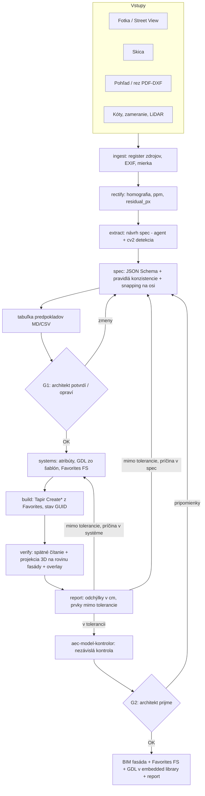

# ADR-001: BIM fasáda z obrázka (foto / skica / pohľad / rez → ArchiCAD 29)

| Pole | Hodnota |
|---|---|
| Stav | NAVRHNUTÉ (2026-10-19) |
| Rozhoduje | architekt (používateľ) – rozhodnutia delegoval na tím; otvorené otázky v kap. 11 |
| Nadväzuje na | `aec-archicad-modeler`, `aec-model-kontrolor`, `aec-prieskumnik`; súkromný Tapir 1.7.2 (`CreateRailings`, `CreateCurtainWalls`) |
| Repo | `C:\tapir-private` (C++ add-on, pravidlá v `CLAUDE.md` → „Adding or changing a command") |
| Piloty | A: Senec – Lichnerova (`OneDrive\AT_Verejny_priestor_Senec\Fasady_model`), B: administratívna CW fasáda z fotky |

## 1. Kontext

Cieľ používateľa: *„vstup obrázok, prípadne sketch, prípadne pohľady, rezy → výsledok BIM vymodelovaná fasáda"*, plne automaticky vrátane Favorites a GDL.

Čo už existuje a funguje:

| Oblasť | Stav (overené 2026-10-19, ak nie je uvedené inak) |
|---|---|
| Čítanie fotky | Pilot Senec: rektifikácia (`rect.py`, `fasady.py`: homografia, `ppm`, `facade_support`, `cam_height_check_m`), odčítanie otvorov `(s0, s1, v0, v1)` z metrickej mriežky, značky ODHAD. 52 domov hotových – ale ako **morfy** (plastický model), nie BIM prvky. |
| Tapir – prvky | Create/Modify Walls, Slabs, Windows, Doors, Openings, Columns, Beams, Roofs, Morphs, Meshes, Objects, Zones; súkromne `CreateRailings`, `CreateCurtainWalls` (raster, triedy buniek). |
| Tapir – systémy | Favorites (Get/Create/Update/Rename/Delete/Import/Export/Apply…), `CreateComposites`, `CreateSurfaces`, `CreateBuildingMaterials`, `CreateLayers`, `CreateProfiles` (len kópia existujúcej geometrie), GDL parametre prvkov aj podprvkov CW, `AddFilesToEmbeddedLibrary`, `ReloadLibraries`. |
| Tapir – kontrola | `Get3DGeometryOfElements`, `GetSubelementsOfHierarchicalElements`, `GetSectionElements`, `ChangeWindow`, `SaveCurrentWindowAsImage`, `GetElementPreviewImage`. |
| Medzery | Detaily zábradlia (len z Favorite; `ApplyFavoritesToElements` memo pri Railing/Stair/CW neaplikuje), definícia tried rámov/panelov CW (len výber z existujúcich), profil z polygónu, tvorba GDL objektov. |

Overené v hlavičkách DevKitu AC29 (`Support\Inc`):

| Funkcia | Zistenie | Dôsledok |
|---|---|---|
| `ACAPI_Element_ChangeDefaults` | memo sa používa **len** pre Window/Door/Object/Lamp/Room/Label/Picture/External (ACAPinc.h:2902) | detaily zábradlia cez defaults nejdú → cesta cez vzorový prvok |
| `ACAPI_Element_ChangeDefaultsExt` | výslovne podporuje `API_CurtainWallID`, `…PanelID`, `…FrameID`, `…JunctionID`, `…AccessoryID` (ACAPinc.h:2924) | triedy CW sa dajú nastaviť do predvolieb → Favorite |
| `ACAPI_Element_GetMemo` / memo masky | Railing: `railingSegments`, `railingPatterns`, `railingPosts`, `railingToprails`, `railingHandrails`, `railingPanels`, `railingBalusters`… (APIdefs_Elements.h:18125–18221) | čítanie áno; zápis cez `ACAPI_Element_Change` s memom **NEOVERENÉ** |
| `ACAPI_LibraryPart_Create/AddSection/Save` | existuje, označené *Legacy – use ACAPI::LM::GSMObject* (ACAPinc.h:2569); `GSMObject.hpp` v `Modules\ArchicadAPI\ACAPI\Library` | C++ cesta možná, ale preferujeme cestu bez C++ (kap. 8, T5) |
| `ACAPI_LibraryManagement_InterpretGDLScript3D` | existuje (ACAPI_Goodies.h:1234); `InterpretGDLScript` (2D) v AC29 nie je pod týmto menom | rýchly test 3D skriptu šablóny bez umiestnenia |
| `API_ProfileAttrType` + `profile_vectorImageItems` | profil z 2D výplní (`ProfileVectorImage`); DevKit odkazuje na príklad *Attribute_Test* | `CreateProfilesFromPolygons` je realizovateľné; príklad v lokálnom DevKite **NEOVERENÉ** |
| `ACAPI_Favorite_Create/Change` | `API_Favorite` s prvkom + memom, `Change` s `elementMask`/`memoMask` | či memo CW/Railing do Favorite prejde: **NEOVERENÉ** |

## 2. Rozhodnutie (súhrn)

| # | Rozhodnutie | Zdôvodnenie |
|---|---|---|
| D1 | Jediný kontrakt medzi „čítaním obrázka" a „modelovaním" je **strojová špecifikácia fasády** `facade-spec/1` (JSON + JSON Schema). Každá číselná hodnota nesie zdroj a istotu. | Oddelí neisté vnímanie od deterministického modelovania; moduly sa dajú testovať izolovane; Senec dáta sa dajú skonvertovať. |
| D2 | Poradie realizácie prvku: **natívny nástroj ArchiCADu → Favorite → GDL objekt zo šablóny → morf** (morf len ako vykázaná výnimka). | BIM hodnota (IFC, výkazy, editovateľnosť architektom); zhoda s pravidlami `aec-archicad-modeler` (zákaz „hranolov hmoty"). |
| D3 | Systémy (skladby, typy okien, CW systémy, zábradlia, profily) sú v špecifikácii **katalóg `systems`**; modul `systems` z neho idempotentne vyrobí atribúty a Favorites s prefixom `FS `. Prvky sa potom vytvárajú **len z Favorites**. | Favorite je jediná spoľahlivá cesta pre Railing/CW (overené); architekt dostane znovupoužiteľnú knižnicu. |
| D4 | Detaily, ktoré cez defaults nejdú (zábradlie), sa robia vzorom **„vzorový prvok"**: vytvor z najbližšieho Favorite → uprav prvok/podprvky → `CreateFavoritesFromElements` → zmaž vzor. | Používa overené príkazy; nový C++ len na úpravu detailov. |
| D5 | GDL objekty vznikajú z **malej sady parametrických šablón** (verzionované v repe), nie generovaním GDL per fasáda. Preferovaná cesta: XML šablóna → `LP_XMLConverter` (súčasť inštalácie ArchiCADu) → `.gsm` → `AddFilesToEmbeddedLibrary` → `ReloadLibraries`. C++ príkaz T5 len ak táto cesta zlyhá. | Nulový C++, žiadny reštart ArchiCADu; šablóna testovateľná mimo projektu. |
| D6 | Spätná kontrola je **dvojitá**: (a) čísla – spätné čítanie prvkov vs. špecifikácia, (b) obraz – ortografická projekcia 3D geometrie modelu na rovinu fasády prekrytá cez rektifikovaný vstup, odchýlky v cm. Natívny pohľad ArchiCADu (`ChangeWindow` + `SaveCurrentWindowAsImage`) je doplnok. | (b) je deterministické, beží v tichom režime a nepotrebuje pohľadový marker. |
| D7 | Človek v slučke má **dve brány**: G1 potvrdenie tabuľky predpokladov (pred stavbou), G2 prijatie výsledku (po kontrole). Inak beží slučka sama. | Architekt nechce programovať, ale musí schváliť to, čo nie je z kóty. |
| D8 | Orchestrácia v Pythone (`C:\tapir-private\private-tools\facade_pipeline\`), Tapir príkazy sú len atómy. Nové C++ príkazy sa zoskupujú do dávok (1 build + 1 reštart na inkrement). | Reštart robí používateľ; minimalizovať počet reštartov. |

## 3. Pipeline end-to-end



### 3.1 Vstupy a zdroj každej hodnoty

| Vstup | Rektifikácia / mierka | Typická istota | Pozn. |
|---|---|---|---|
| Fotka (čelná, šikmá) | homografia roviny fasády (úbežníky, `cv2.findHomography`), mierka z 1 známej šírky (model, zameranie, OSM) alebo 2 koncov | `meranie` ±3–10 cm (ODHAD, závisí od `facade_support`, uhla a ppm) | prvky mimo roviny (balkón, rímsa) sa posúvajú – poloha z 2 záberov alebo `odhad` (POSTUP Senec §10) |
| Skica | bez perspektívy; mierka z 1 kóty alebo z typovej výšky podlažia | `odhad`, pri kóte `kota` | skica je zámer, nie skutočnosť – hodnoty sa snapujú na raster |
| Pohľad / rez (PDF z CADu, DXF) | mierka z výkresu (DXF v mm presne, PDF z mierky + kontrola kótou) | `kota` / `meranie` ±1 cm | rez = hlavný zdroj hĺbok (ostenie, predsadenie, rímsy, skladby) |
| Zameranie, LiDAR | priamo v súradniciach modelu | `meranie` | päta, rímsa, hrebeň |
| Pravidlo / typológia | – | `pravidlo` | napr. parapet 0,9 m, ak nevidno; vždy do tabuľky G1 |

Úrovne istoty (`conf`): `kota` > `meranie` > `pravidlo` > `odhad` > `default` (hodnota systému bez podkladu). Do G1 idú všetky hodnoty pod `meranie`.

### 3.2 Človek v slučke

| Brána | Čo vidí architekt | Čo robí | Formát |
|---|---|---|---|
| G1 | tabuľka predpokladov: hodnota, jednotka, zdroj, istota, návrh; náhľad rektifikovaného obrázka s vyznačenými otvormi a osami | potvrdí / prepíše hodnotu / zmení systém (napr. „okná 3-krídlové") | `out/<spec>/assumptions.md` + `.csv` (stĺpec `schvalene`) |
| G2 | overlay model × vstup, tabuľka odchýlok, 3D snímka | prijme / napíše pripomienku vetou | `out/<spec>/report.md` |

Prázdna odpoveď v G1 = prijatie návrhov (plná automatizácia podľa želania); G1 sa nikdy nepreskakuje potichu – vždy sa vygeneruje a zaloguje.

## 4. Strojová špecifikácia `facade-spec/1`

Súradnice: **lokálny systém fasády** `s` (m po referenčnej čiare zľava doprava pri pohľade zvonku), `v` (m nad `z0`), `w` (m von z roviny fasády) – rovnaká konvencia ako `Path` v pilote Senec. Transformácia do modelu cez `reference`.

```json
{
  "schema": "facade-spec/1",
  "id": "M015",
  "reference": {"a": [12.40, -3.10], "b": [24.85, -1.95], "z0": {"v": -2.21, "src": "S3", "conf": "meranie"},
                "outside": "right_of_ab", "layer": "FASADA – M015"},
  "sources": [
    {"id": "S1", "type": "photo", "file": "01_podklady/foto/IMG_8441.JPG",
     "rect": {"H": [[...]], "ppm": 98.4, "residual_px": 2.1, "facade_support": 0.71, "scale_from": "width_model"}},
    {"id": "S3", "type": "survey", "file": "01_podklady/survey_model_xyz.npy"}
  ],
  "stories": [{"id": "1NP", "level": {"v": 0.00, "src": "S1", "conf": "meranie"}},
              {"id": "2NP", "level": {"v": 3.35, "src": "S1", "conf": "odhad"}}],
  "axes": {"s": [0.0, 2.10, 4.85, 7.60, 10.35, 12.45], "snap_tol": 0.05},
  "zones": [{"id": "Z1", "kind": "wall", "rect": [0, 12.45, 0, 7.20], "system": "wall.omietka_450"}],
  "openings": [{"id": "O1", "kind": "window", "rect": {"v": [2.10, 3.30, 0.95, 2.45], "src": "S1", "conf": "meranie"},
                "system": "win.2kr_ks", "reveal": {"v": 0.12, "src": null, "conf": "odhad"}, "sill_out": "sill.plech"}],
  "cw_fields": [{"id": "CW1", "polygon": [[0,0],[12.45,0],[12.45,3.6],[0,3.6]], "system": "cw.stl_50",
                 "u_pattern": {"kind": "FixedSizes", "sizes": [1.35]}, "v_pattern": {"kind": "FixedSizes", "sizes": [0.9, 2.7]},
                 "cells": [{"row": 0, "panel": "opaque"}]}],
  "railings": [{"id": "R1", "path": [[3.0, 3.35, 1.20], [9.0, 3.35, 1.20]], "system": "rail.plech_1000"}],
  "linear": [{"id": "L1", "kind": "cornice", "s": [0, 12.45], "v": {"v": 7.20, "src": "S1", "conf": "meranie"},
              "profile": "prof.rimsa_A"}],
  "slabs": [{"id": "B1", "kind": "balcony", "outline_sw": [[3.0,0],[9.0,0],[9.0,1.2],[3.0,1.2]], "v_top": 3.35, "system": "slab.balkon_180"}],
  "shading": [{"id": "SH1", "field": "CW1", "system": "gdl.louvers_h", "params": {"pitch": 0.25, "depth": 0.20, "angle": 30}}],
  "anchoring": [{"id": "A1", "applies_to": "cladding", "system": "anch.konzola_al", "spacing": [0.6, 1.2], "model": "property_only"}],
  "systems": {
    "wall.omietka_450": {"type": "composite", "layers": [["Omítka - venkovní", 0.02], ["EPS", 0.15], ["Zdivo", 0.30]]},
    "win.2kr_ks":  {"type": "window", "base_libpart": "Window 29", "frame": 0.07, "mullions": 1, "transoms": 0},
    "cw.stl_50":   {"type": "curtain_wall", "frame": {"width": 0.05, "depth": 0.15}, "panels": {"glass": 0.024, "opaque": 0.10}},
    "rail.plech_1000": {"type": "railing", "height": 1.0, "post_spacing": 1.5, "infill": "panel", "base_favorite": "FS base railing panel"},
    "prof.rimsa_A": {"type": "profile", "polygon_wv": [[0,0],[0.35,0],[0.35,0.12],[0.18,0.30],[0,0.30]], "material": "Omítka - venkovní"},
    "gdl.louvers_h": {"type": "gdl", "template": "FS_Louvers", "version": "1.0"}
  },
  "assumptions": [{"ref": "openings[O1].reveal", "value": 0.12, "why": "ostenie nevidno, typológia", "status": "pending"}],
  "tolerances": {"kota": 0.01, "meranie": 0.05, "pravidlo": 0.10, "odhad": null}
}
```

Pravidlá konzistencie (modul `spec`, bez ArchiCADu): otvory sa neprekrývajú a ležia v zóne `wall`; okná nad sebou zarovnané do osí (`snap_tol`); parapet ≠ 0 pri `conf=odhad` (pravidlo modelera č. 13); každý `system` existuje v katalógu; CW raster pokryje pole; zábradlie stojí na doske/parapete; žiadny prvok mimo `0…L`. Porušenie = chyba (nie varovanie).

Adaptér `from_senec`: prevod `domy_blok*.py` (otvory `(s0,s1,v0,v1)`, `z0`, `info["odhady"]`, rímsy zo `sbox`) do `facade-spec/1` – pilot A tak nevyžaduje nové čítanie fotiek.

## 5. Moduly a kontrakty

Balík `facade_pipeline` (Python 3.12). Každý modul = čistá funkcia nad súbormi; ArchiCAD potrebujú len `systems`, `build`, `verify`.

| Modul | Vstup | Výstup | ArchiCAD | Test izolovane |
|---|---|---|---|---|
| `ingest` | priečinok vstupov, `sources.yaml` | `sources[]` (typ, súbor, EXIF/GPS, mierka výkresu) | nie | fixture obrázky |
| `rectify` | `sources[i]`, ROI, známa šírka | rektifikovaný PNG + mriežka, `H`, `ppm`, `residual_px`, `facade_support` | nie | syntetická fasáda s known homography (chyba < 1 px) |
| `extract` | rektifikované obrázky, pohľady/rezy | návrh `facade-spec` (otvory, osi, podlažia, zóny, systémy z typológie) | nie | porovnanie so Senec `domy_blok` (recall otvorov) |
| `spec` | návrh spec, odpovede G1 | validovaná spec, `assumptions.md/.csv` | nie | JSON Schema + jednotkové testy pravidiel |
| `systems` | `spec.systems` | `manifest.json`: systém → atribút index / Favorite meno / libpart GUID | áno | na prázdnom testovacom projekte; idempotencia (2. beh = 0 zmien) |
| `build` | spec + manifest | prvky v ArchiCADe, `state.json` (GUID per `id` spec) | áno | idempotentný rebuild jednej fasády; maže len GUID zo stavu |
| `verify` | spec + state + rektifikované vstupy | `deviations.csv` (prvok, os, spec, model, Δ cm, tolerancia, OK), `overlay_*.png`, 3D snímka | áno (čítanie) | projekcia na syntetickom modeli |
| `report` | výstupy `verify`, história iterácií | `report.md` pre G2 | nie | snapshot test |

Rozdelenie na agentov: `aec-prieskumnik` → `ingest` (fotky, Street View); čítanie (`rectify`, `extract`, `spec`) → `aec-archicad-modeler` v režime „čítanie" (alebo nový agent `aec-fasada-citac`, ak sa ukáže, že kontext nestačí); `systems` + `build` → `aec-archicad-modeler` (do ArchiCADu zapisuje vždy len jeden); `verify` → skript + `aec-model-kontrolor` nad overlaymi.

Konvencie v modeli: vrstva `FASADA – <spec.id>`, Element ID `<spec.id>.<prvok.id>` s príponou `?` pri `conf ∈ {odhad, default}` (pravidlo modelera č. 26), vlastnosti `FS_zdroj`, `FS_istota`, `FS_spec` (cez `CreatePropertyDefinitions` + `SetPropertyValuesOfElements`), Favorites `FS <system-id>`.

## 6. Mapovanie prvkov fasády na systémy ArchiCADu

| Prvok spec | Nástroj ArchiCADu | Systém (zdroj nastavení) | Tapir |
|---|---|---|---|
| `zones[kind=wall]` | Wall (skladba) | Composite + Favorite `FS wall.*` | `CreateComposites`, `CreateWalls`/`ModifyWalls` |
| `openings[window/door]` | Window / Door v stene | Favorite `FS win.*` (knižničný prvok + GDL parametre delenia) | `CreateWindows`/`CreateDoors`, `SetGDLParametersOfElements` |
| `openings[kind=opening]` | Empty Opening | – | `CreateOpenings` |
| `cw_fields` | Curtain Wall | Favorite `FS cw.*` s triedami rámov/panelov | `CreateCurtainWalls` + **T2** |
| `railings` | Railing | Favorite `FS rail.*` (vzorový prvok) | `CreateRailings` + **T3** |
| `linear` (rímsa, pás, sokel, atika) | Beam / Wall s Complex Profile | Profile atribút + Favorite | **T1**, `CreateBeams`/`CreateWalls` (priradenie profilu **NEOVERENÉ** v schéme Tapiru) |
| `slabs[balcony]` | Slab | Composite | `CreateSlabs` |
| obklad (panely, rastre) | LOD1 vrstva skladby; LOD2 CW ako rainscreen alebo GDL pole panelov | composite / `FS cw.*` / `FS_CladdingPanels` | existujúce + T2 / šablóna |
| `shading` (lamely, slnolamy) | Object (GDL) | šablóna `FS_Louvers` | GDL cesta D5, `CreateObjects` |
| šambrány, ozdoby (pilot A) | Object (GDL) `FS_Surround`; výnimočne morf | šablóna | D5 |
| `anchoring` | len vlastnosti (LOD1–2), GDL `FS_Bracket` pole (LOD3) | – | `SetPropertyValuesOfElements` |

## 7. Gap analýza

Priorita = frekvencia prvku na bežných fasádach (V vysoká / S stredná / N nízka) × prínos; náročnosť: M (≤ 1 deň), S (2–4 dni), V (týždeň+ / výskum).

| Prvok | Čo treba | Čo API/Tapir má | Čo chýba | Ako doplniť | Náročnosť | Priorita |
|---|---|---|---|---|---|---|
| Stena + skladba | stena po zóne, skladba, Home Story, top link | `CreateWalls` (`structureType` + `compositeId`), `CreateComposites`, `GetComposites` | nič (**overené I2**: prvá vrstva skladby = vonkajšie líce pri ref. čiare `Outside`) | `systems.py`: skladba porovnaná `GetComposites` pred zápisom; Favorite `FS wall.*` zo vzorovej steny (povrchy bez prepisu) | M | V |
| Okná / dvere – poloha | otvor v stene, parapet, výška | `CreateWindows/Doors` (z Favorite) | nič | – | M | V |
| Okná – typ (delenie, rám) | počet krídel, priečnik, šírka rámu | GDL parametre prvku, `CreateFavoritesFromElements` / `UpdateFavoritesFromElements` | **overené I2**: `facade/gdl_param_map.json` (Double Window 27, Door 27, Door with Sidelight on Side 1 and Transom 27, Garage Double Door 27); počet krídel = podtyp knižničnej časti, nie parameter; obsah Favorite sa nedá čítať → idempotencia cez manifest s hashom | podtyp, ktorý v šablóne nemá Favorite, ide len cez `libraryPartName` → **T7** | S | V |
| Ostenie, vonkajší parapet | hĺbka osadenia, parapetný plech | **overené I2**: `ModifyWindows/ModifyDoors` `refSide: true` + `revealDepthOffset` (od vonkajšieho líca; spätne `AC_wido_sill`); typ ostenia `gs_reveal_type_int` = 2, omietka sa neotáča `gs_bAutoTurnIn` = false | `revealDepthLocation` (Side/Core) sa nedá nastaviť – pri kompozitnej stene Favorites merajú od jadra → v `build.py` odpočet vonkajších vrstiev | **T8** (malé rozšírenie Modify*) | M | S |
| Dvere s bočným svetlíkom a nadsvetlíkom | výklad + dvere v jednom ráme, parapet pod svetlíkom | podtyp `Door with Sidelight on Side 1 and Transom 27` z Favorite „… vchodové 03" | nič (**overené I2**: otvor v stene má tvar L, parapet ostane stenou) | `merged_into` v spec; šírka svetlíka = viditeľná + `gs_frame_width` | M | V |
| Balkónová doska | doska, hrúbka, presah | `CreateSlabs` | nič | – | M | V |
| Zábradlie – výška a výplň | výška, rozostup stĺpikov, madlo, výplň (panel/priečky) | `CreateRailings` z Favorite, čítanie memo | zápis detailov | **T3** `ModifyRailingDetails`; fallback: 4–5 ručných Favorites (jednorazový krok) | V | V |
| Rímsy, pásy, sokel, atika | ťahaný profil z polygónu | `CreateProfiles` (len kópia) | profil z polygónu | **T1** `CreateProfilesFromPolygons` | S | V (historické) / S |
| CW – raster a bunky | raster, triedy buniek | `CreateCurtainWalls` (overené) | nič | – | – | S |
| CW – systém (rámy, panely) | šírka/hĺbka rámu, typ panelu, hrúbka, materiál | výber existujúcich tried | definícia tried | **T2** `SetCurtainWallSystemDefaults` (+ Favorite) | S | S |
| Obklad – panely | raster panelov, škáry, hrúbka | skladba (LOD1), CW (LOD2) | GDL pole panelov | šablóna `FS_CladdingPanels` | S | S |
| Tienenie – lamely | pole lamiel, rozostup, uhol, hĺbka | `CreateObjects`, GDL parametre | objekt | šablóna `FS_Louvers` | S | S |
| Parapetný / nadpražný panel | nepriehľadné pole v CW alebo v stene | CW triedy (po T2) | – | T2, alt. `FS_SpandrelPanel` | M | S |
| Šambrány, nadokenné rímsy | rám okolo otvoru s profilom | – | objekt | šablóna `FS_Surround` (profil + rozmery otvoru) | S | S (pilot A) / N |
| Kotvenie | info, LOD3 konzoly | vlastnosti | – | vlastnosti; `FS_Bracket` až na požiadanie | M | N |
| Zdroj a istota v modeli | vlastnosti per prvok | `CreatePropertyDefinitions`, `SetPropertyValuesOfElements` | nič | – | M | V |
| Kontrola – projekcia | 3D geometria → rovina fasády | `Get3DGeometryOfElements` | nič (Python) | modul `verify` | S | V |
| Kontrola – natívny pohľad | pohľad rovnobežný s fasádou | `ChangeWindow`, `SaveCurrentWindowAsImage` | tvorba pohľadového markera | **T6** `CreateElevationAlongLine` | V | N |
| GDL – tvorba objektu | `.gsm` zo šablóny | `AddFilesToEmbeddedLibrary`, `ReloadLibraries`, GDL params | kompilácia XML → GSM | `LP_XMLConverter` (D5); fallback **T5** | S (M ak converter funguje) | V |

## 8. Nové Tapir príkazy

Spoločné: schéma cez `tools/new_command.py`, registrácia v `AddOnMain.cpp` s verziou z `tools/package_info.json`, príklad v `Examples/`, test v `private-tests/test_tapir_private.py`; každý zápis v `ACAPI_CallUndoableCommand`; po vytvorení vrátiť GUID/index a pri chybe text chyby per položka (nie celá dávka).

| ID | Príkaz | Vstup (polia) | Výstup | API | Riziká |
|---|---|---|---|---|---|
| T1 | `CreateProfilesFromPolygons` | `profiles[]: {name, polygons[]: {outer: [[x,y]…], holes?: [[[x,y]…]]}, buildingMaterial (name/index), useWith: {wall, beam, column, handrail}, overwriteExisting}`; x = von z fasády, y = hore, m | `attributes[]: {attributeId, index}` / `error` | `ACAPI_Attribute_CreateExt` / `ModifyExt` s `API_ProfileAttrType`, `API_AttributeDefExt.profile_vectorImageItems` (`ProfileVectorImage`: výplň + `ProfileItem` so stavebným materiálom) | zostavenie `ProfileVectorImage` (HGX) nie je triviálne; vzor *Attribute_Test* v DevKite **NEOVERENÉ** lokálne; oblúky → polygón |
| T2 | `SetCurtainWallSystemDefaults` | `frameClasses[]: {name, kind (generic / buttGlazed / …), width, depth, offset, buildingMaterial, surface?}`, `panelClasses[]: {name, kind (glass/opaque), thickness, buildingMaterial}`, `boundaryFrameClass`, `favoriteName?` | `frameClasses[]: {name, classIndex}`, `panelClasses[]`, `favoriteName` | `ACAPI_Element_GetDefaultsExt` / `ChangeDefaultsExt` pre `API_CurtainWallID` + memo `cWallFrameDefaults`, `cWallPanelDefaults`; podprvky `API_CurtainWallFrameID/PanelID`; potom `ACAPI_Favorite_Create` (alebo vzorový prvok + `CreateFavoritesFromElements`) | mapovanie `kind` na GDL objekty rámov (`libInd`) a ich parametre; či `Favorite_Create` uloží CW memo **NEOVERENÉ** → záložná cesta vzorový prvok |
| T3 | `ModifyRailingDetails` | `railings[]: {elementId, height?, segments?: {postSpacing, postLibPart?}, toprail?: {enabled, height, profile/libPart}, handrail?: {enabled, height, side}, infill?: {kind: panel/balusters/rails, panelThickness?, balusterSpacing?, railCount?}}` | `results[]: {elementId, changed: [...], error?}` | `ACAPI_Element_GetMemo` (masky `APIMemoMask_Railing*`), úprava `railingSegments`, `railingPatterns`, `railingPosts`, `railingToprails`, `railingHandrails`, `railingPanels`, `railingBalusterSets`; zápis `ACAPI_Element_Change` s memoMask alebo po podprvkoch (`API_RailingPostID` …) | **najvyššie riziko**: hierarchia vzorov, konzistencia indexov, chýbajúca dokumentácia správania; zápis memo **NEOVERENÉ** → najprv spike (1 deň), pri neúspechu fallback ručné Favorites + zmena len výšky |
| T4 | `CreateFavoritesFromDefaults` | `favorites[]: {name, elementType (Window/Door/Object/Lamp), libPartName, gdlParameters{}, layer?, classifications?, properties?}` | `favorites[]: {name, created/updated}` | `ACAPI_Element_GetDefaults` → memo `params` (`ACAPI_LibraryPart_GetParams`) → `ACAPI_Favorite_Create/Change` | len knižničné prvky (memo podľa doc. 2902); pre ostatné vzorový prvok (D4) |
| T5 | `CreateLibraryPartFromScripts` (len fallback D5) | `{name, parentSubtype (Object/Window/Door), scripts: {master, 2d, 3d, parameter, ui?}, parameters[]: {name, type, value, description}, target: embedded}` | `{libPartGuid, index}` | `ACAPI_LibraryPart_Create`, `AddSection`, `GetSect_ParamDef`, `Save` (legacy) alebo `ACAPI::LM::GSMObject` | legacy API; cieľová lokácia embedded library **NEOVERENÉ**; chyby GDL až pri umiestnení |
| T6 | `CreateElevationAlongLine` | `{name, begin, end, depth, viewDirection, horizontalRange, verticalRange}` | `{elementId, navigatorItemId}` | `ACAPI_Element_Create` s `API_ElevationID` + marker (`ChangeDefaultsExt` markera) | marker a rozsahy sú zložité; nízka priorita, projekcia v `verify` to nahrádza |
| T7 | oprava `CreateWindows/CreateDoors.libraryPartName` (nález I2) | bez zmeny schémy | prvok, ktorého GDL parametre sa dajú čítať aj zapisovať | `ApplyWindowOrDoorLibraryPartToDefaults` dáva do memo `params` výsledok `ACAPI_LibraryPart_GetParams`; vzniknutý prvok potom zlyhá v `ACAPI_LibraryPart_OpenParameters` (APIERR_GENERAL) v Get/SetGDLParametersOfElements a Favorite z neho zdedí to isté (overené 2026-10-19 na „Double Door with Transom 27" a „Door with Sidelight on Side 1 and Transom 27"; tie isté podtypy cez Favorite fungujú). Návrh: po vytvorení prepočítať parametre (`OpenParameters` na libpart + `GetActParameters` + `ACAPI_Element_Change` s memom `params`), alebo brať defaults zo vzorového prvku | bez T7 sú dostupné len podtypy, ktoré majú Favorite v šablóne – dvojkrídlové dvere s nadsvetlíkom chýbajú (brána O2 pilota A je výnimka) |
| T8 | `revealDepthLocation` v `ModifyWindows/ModifyDoors` (+ čítanie v `GetDetailsOfElements`) (nález I2) | `revealDepthLocation: Side / Core` | `executionResults` | `API_WindowType.revealDepthLocation` (`APIWDRevealDepth_Side/Core`) s maskou | malé; dnes nahradené odpočtom vonkajších vrstiev skladby v `build.py` |

## 9. Poradie implementácie (inkrementy)

Každý inkrement končí akceptačným testom **naostro v ArchiCADe 29** na kópii projektu (nikdy template `C:\ArchicadTemp`), skriptom s timeoutom a viditeľným výstupom, a záznamom do `private-tests`.

| # | Obsah | Nový C++ / reštart | Akceptačný test (naostro) | Čo z pilotov pôjde vymodelovať |
|---|---|---|---|---|
| I1 | `facade-spec/1` (podmnožina: `reference`, `stories`, `zones[wall]`, `openings`), validátor, adaptér `from_senec`, `build` stien + okien + dverí z existujúcich Favorites, `verify` s projekciou a overlayom | nie | Senec dom **M015_L1** (6 okien, 1 dvere): počet otvorov v modeli = spec; Δ poloha/rozmer otvorov model vs. spec ≤ 1 cm; overlay PNG cez `fasada_*_rektif.jpg`; 2. beh `build` = 0 zmien; čas < 2 min | **viditeľný výsledok**: prvá BIM fasáda (stena + výplne) vedľa morfového modelu; pilot A L1 |
| I2 ✔ | katalóg `systems`: skladby (`CreateComposites`), typy okien (vzorový prvok → `CreateFavoritesFromElements`, `gdl_param_map.json`), vlastnosti `FS_*`, tabuľka G1 | nie | 2 typy okien z spec → 2 Favorites `FS win.*`; okná majú delenie podľa spec (GDL parametre čítané späť = spec); stena má skladbu; každý prvok má `FS_zdroj`/`FS_istota`; idempotentný 2. beh | pilot A L1 s typmi okien a skladbou; G1 prvýkrát s architektom |
| I3 | **T1** `CreateProfilesFromPolygons` + **T4**; `linear` (rímsy, pás, sokel) ako nosník/stena s profilom; balkónové dosky | áno (T1 + T4 v 1 builde) | profil z polygónu: plocha prierezu z ArchiCADu = polygón ±1 %; rímsa M016/M062 na výške spec ±1 cm; overlay rímsy ±3 cm voči fotke | pilot A L2 (rímsy, sokel, podokenné pásy, balkónové dosky) |
| I4 | GDL šablóny cez `LP_XMLConverter`: `FS_Louvers`, `FS_SpandrelPanel`, `FS_CladdingPanels`, `FS_Surround`; test šablón mimo projektu | nie (ak converter funguje) | každá šablóna: `.gsm` sa načíta, objekt sa umiestni `CreateObjects`, `SetGDLParametersOfElements` zmení rozmer, 3D bbox z `Get3DGeometryOfElements` = spec ±5 mm; `ReloadLibraries` bez chýb | pilot A L2–L3 (šambrány); pilot B lamely, parapetné panely |
| I5 | **T2** `SetCurtainWallSystemDefaults`; `cw_fields` zo spec | áno | CW systém zo spec: šírka/hĺbka rámov a hrúbky panelov čítané späť (`GetSubelements…` + GDL parametre podprvkov) = spec; Favorite `FS cw.*` vytvorí rovnaké CW; overlay rastra ±2 cm voči kótam | pilot B: celá CW fasáda (raster, nepriehľadné parapety, rámy) |
| I6 | **T3** `ModifyRailingDetails` (spike → implementácia alebo fallback) | áno | zábradlie zo spec: výška ±1 cm, počet stĺpikov = dĺžka / rozostup (+1), typ výplne zhodný; Favorite `FS rail.*` z neho dá to isté | balkóny pilota A (L2), francúzske okná a terasy pilota B |
| I7 | slučka iterácií automaticky (príčina v spec vs. v systéme), `report`, `aec-model-kontrolor` nad overlaymi, voliteľne **T6** | voliteľne | 1 umelá chyba v spec (posunuté okno o 20 cm) → `verify` ju nájde, slučka opraví, 2. iterácia v tolerancii; G2 report | oba piloty end-to-end |
| I8 | akceptácia s architektom | nie | pilot A: 1 dom L2 end-to-end z fotiek; pilot B: 1 fasáda z 1 fotky + 1 kóty; G2 prijaté | – |

Poznámka k reštartom: I3, I5, I6 = 3 buildy (~5 min) + 3 reštarty ArchiCADu používateľom. Ak T3 spike vyjde, dá sa T2 + T3 spojiť do jedného buildu. T7 a T8 (nálezy I2) pribaliť do buildu I3.

**Stav I2 (2026-10-19):** `private-tests/test_i2_m015.py` 31/31 PASS (v ňom I1 16/16 PASS). Moduly `facade/systems.py`, `facade/g1.py`, `facade/gdl_param_map.json`; typy výplní odčítané z rektifikovanej fotky v `facade/adapters/senec_types/M015_L1.json` (zdroj S6). M015_L1: stena `FS wall.omietka_tehla_450` (omietka 20 / plná tehla 410 / omietka 20 mm), Favorites `FS win.2kr`, `FS door.shop_sl`, `FS door.gate`; O3+O4 jeden prvok (dvere s bočným svetlíkom, otvor tvaru L); hĺbka osadenia podľa spec; `FS_zdroj` / `FS_istota` / `FS_spec` na všetkých 7 prvkoch; 2. beh 0 zmien. Výnimka: nadsvetlík brány O2 (T7) – vykázaný v teste, overlayi aj v G1. Nález v I1: dvere sedeli pri vnútornom líci steny (Wall Inset sa meral od vnútornej strany) – opravené `refSide: true`.

## 10. Piloty

| Pilot | Prečo | Čo pokrýva | Čo nepokrýva |
|---|---|---|---|
| A – Senec, Lichnerova | existujú rektifikované fotky, mriežky, dáta otvorov, `z0` zo zamerania, ODHADy, rendery na porovnanie | steny, okná/dvere, rímsy, sokle, balkóny + zábradlia, šambrány (historické fasády L1–L3) | CW takmer nie; model je plastický (morfy) – BIM fasáda vzniká **vedľa** neho na vrstve `FASADA – <dom>` (alebo v samostatnom projekte, otázka Q1) |
| B – administratívna CW fasáda z fotky | typický moderný prípad: raster, parapetné panely, lamely, zábradlia francúzskych okien | CW systémy, tienenie, obklad, parapetné panely | historické profily |

## 11. Riziká a otvorené otázky (blokujúce)

| # | Otázka / riziko | Prečo blokuje | Návrh (predvolené rozhodnutie, ak sa architekt nevyjadrí) |
|---|---|---|---|
| Q1 | Kam stavať BIM fasádu pilota A: do projektu `Lichnerova Senec 9-10-26.pln` na novú vrstvu, alebo do samostatnej kópie? | zápis do produkčného projektu architekta | samostatná kópia `Fasada_pilot_A.pln` mimo OneDrive; prenos až po G2 |
| Q2 | Vstup pre pilot B: fotka konkrétnej CW fasády + aspoň 1 kóta (šírka poľa alebo výška podlažia) | bez nej nemožno akceptovať I5 | architekt dodá; inak `aec-prieskumnik` nájde verejný príklad (len vizuálna referencia) a mierka bude `odhad` |
| R1 | T3 (detaily zábradlia): zápis memo cez `ACAPI_Element_Change` **NEOVERENÉ** | bez neho „plná automatizácia zábradlí" nie je možná | 1-dňový spike na začiatku I6; fallback: architekt raz vytvorí 4–5 základných Favorites (panel, priečky, tyčky, sklo, plech), automatika mení len výšku a trasu |
| R2 | `LP_XMLConverter` v inštalácii AC29 (cesta, verzia XML formátu) **NEOVERENÉ** | celá GDL cesta D5 | overiť pred I4 (5 min); fallback T5 (C++, legacy API) |
| R3 | Tolerancie akceptácie (`kota` 1 cm, `meranie` 5 cm, `pravidlo` 10 cm, `odhad` netestovaný) sú návrh tímu, nie norma | G2 bez dohodnutých čísel nemá kritérium | prijať navrhnuté hodnoty; architekt ich môže zmeniť v `spec.tolerances` |

## 12. Dôsledky

Pozitívne:
- Každá hodnota v modeli je dohľadateľná (zdroj, istota) – v spec aj vo vlastnostiach prvku.
- Výsledok je skutočný BIM (Wall/Window/CW/Railing/Slab/Object), editovateľný ručne a exportovateľný do IFC; Favorites `FS *` ostávajú architektovi ako knižnica.
- Čítanie obrázka a modelovanie sa vyvíjajú a testujú oddelene; Senec dáta sa dajú použiť bez nového čítania fotiek.

Negatívne / náklady:
- 3–4 C++ buildy s reštartom ArchiCADu; T3 môže skončiť fallbackom s ručným krokom.
- Knižničné parametre okien a rámov CW sú knižnične závislé (`gdl_param_map.json` treba udržiavať pri zmene knižnice AC).
- Prvky mimo roviny fasády (balkóny, rímsy) z jednej fotky budú mať istotu `odhad` – kvalita výsledku závisí od počtu záberov a rezov.
- Ozdobné prvky mimo šablón ostávajú morfom (vykázaná výnimka).

## 13. Závislosti

| Závislosť | Licencia | Zdôvodnenie |
|---|---|---|
| numpy | BSD-3-Clause | geometria, projekcia (už v pilote Senec) |
| opencv-python | Apache-2.0 (OpenCV ≥ 4.5), wrapper MIT | homografia, detekcia hrán/otvorov (už v pilote) |
| Pillow | MIT-CMU (HPND) | overlay obrázky (už v pilote) |
| shapely | BSD-3-Clause | polygóny zón, otvorov, CW polí (už v pilote) |
| jsonschema | MIT | validácia `facade-spec/1` (nová, malá, udržiavaná) |
| LP_XMLConverter | súčasť inštalácie ArchiCADu (Graphisoft), nedistribuujeme ho | XML → GSM pre GDL šablóny |
| ArchiCAD 29 DevKit | licencia Graphisoft API Developer | nové Tapir príkazy |

Žiadne secrets, žiadne online služby v pipeline (Street View len ako vizuálna referencia cez `aec-prieskumnik`, podľa pravidiel projektu).
